<!-- @generated by er-entity-gen — DO NOT EDIT. Regenerate with `er-entity gen`;
`er-entity verify` (CI) fails when this file is stale. -->

# Entity-relationship diagram

Every relation of every store, drawn from the schema authorities themselves: the
entity catalog (`entities/*/entity.yaml`) for the Postgres control plane, the
drizzle snapshot (`frontend/drizzle/meta/`) for the frontend's `erweb` schema, and
the `er-schema` S5 registry for the DuckLake lake. Attribute markers: `PK` the
primary/logical key, `FK` a declared foreign key, `UK` a unique index.

## Contents

- [Control plane — Postgres `public`](#control-plane--postgres-public)
- [Frontend BFF — Postgres `erweb`](#frontend-bff--postgres-erweb)
- [Data plane — DuckLake `lake.main`](#data-plane--ducklake-lakemain)

## Control plane — Postgres `public`

The erserver control database, provisioned at boot from the generated
`POSTGRES_BASELINE`. Every edge is a declared foreign key (`references:` in the
entity spec); a dotted edge means the referencing column is nullable.

```mermaid
erDiagram
    api_keys {
        varchar id PK
        varchar org_id FK
        varchar role "in {admin, steward, viewer}"
        varchar key_hash
        timestamp created_at
        timestamp revoked_at
        timestamp updated_at
    }
    audit_log {
        bigint id PK
        timestamp at
        varchar actor
        varchar org
        varchar dataset
        varchar action
        varchar trace_id
        json detail
        timestamp created_at
        timestamp updated_at
    }
    config_versions {
        varchar id PK
        varchar org_id FK
        varchar dataset_id FK
        bigint version
        varchar yaml
        varchar config_hash
        varchar state "in {draft, published}"
        varchar tier
        varchar created_by
        timestamp created_at
        timestamp published_at
        timestamp updated_at
    }
    datasets {
        varchar id PK
        varchar org_id FK
        varchar name
        varchar display_name
        varchar entity_type "in {account, person}"
        varchar config_path
        json env
        varchar drop_root
        varchar s3_ingest_bucket
        varchar s3_ingest_prefix
        bigint active_config_version
        varchar state "in {active, provisioning, purging, suspended}"
        timestamp created_at
        timestamp updated_at
    }
    ddl_log {
        bigint id PK
        timestamp created_at
        timestamp updated_at
        varchar actor
        varchar phase "in {ddl_command_end, sql_drop}"
        varchar ddl_tag
        varchar object_type
        varchar object_identity
        varchar command_text
    }
    entity_links {
        varchar id PK
        varchar org_id FK
        varchar dataset_id FK
        varchar parent_entity_id
        varchar child_entity_id
        varchar kind "in {company, household, related}"
        varchar origin "in {llm, manual, rule}"
        varchar note
        varchar created_by
        timestamp created_at
        timestamp updated_at
    }
    fixups {
        varchar id PK
        varchar name
        varchar applied_by
        timestamp created_at
        timestamp updated_at
    }
    jobs {
        varchar id PK
        varchar org_id FK
        varchar dataset_id FK
        varchar kind
        json params
        varchar state
        bigint priority
        varchar idempotency_key
        varchar run_id
        bigint attempt
        bigint max_attempts
        varchar error_class
        varchar error_detail
        timestamp not_before
        varchar created_by
        varchar schedule_id
        varchar resource_class
        varchar trace_context
        varchar structural_fingerprint
        varchar policy_hash
        varchar image_digest
        bigint clear_number
        varchar owner_epoch
        timestamp created_at
        timestamp updated_at
        timestamp started_at
        timestamp finished_at
    }
    matching_models {
        varchar id PK
        varchar org_id FK
        varchar dataset_id FK
        varchar name
        bigint version
        varchar entity_type "in {account, person}"
        varchar model_json
        varchar model_hash
        varchar model_version_label
        varchar tf_snapshot_id
        varchar state "in {active, archived, draft}"
        json provenance
        varchar created_by
        timestamp activated_at
        timestamp created_at
        timestamp updated_at
    }
    orgs {
        varchar id PK
        varchar name
        varchar config_path
        json env
        varchar drop_root
        varchar s3_ingest_bucket
        varchar s3_ingest_prefix
        bigint active_config_version
        varchar state "in {active, provisioning, purging, suspended}"
        bigint max_concurrent_jobs
        timestamp created_at
        timestamp updated_at
    }
    pair_labels {
        varchar id PK
        varchar org_id FK
        varchar dataset_id FK
        varchar rec_a_key
        varchar rec_b_key
        varchar verdict "in {match, no_match}"
        varchar origin "in {human, llm, reviewer}"
        varchar labeled_by
        varchar model_version
        double score_at_label
        varchar note
        timestamp created_at
        timestamp updated_at
    }
    s3_ingest_cursors {
        varchar id PK
        varchar org_id FK
        varchar dataset_id FK
        varchar source
        varchar object_key
        varchar etag
        bigint size_bytes
        varchar delivery_id
        timestamp created_at
        timestamp updated_at
    }
    schedules {
        varchar id PK
        varchar org_id FK
        varchar dataset_id FK
        varchar kind
        json params
        varchar cron
        boolean enabled
        varchar source
        timestamp last_enqueued_at
        timestamp created_at
        timestamp updated_at
    }
    schema_migrations {
        varchar id PK
        timestamp created_at
        timestamp updated_at
        varchar catalog_hash
        varchar kind "in {applied, verified}"
        varchar relation
        varchar statement
        varchar applied_by
    }
    staged_steward_actions {
        varchar id PK
        varchar org_id FK
        varchar dataset_id FK
        json action
        varchar state "in {applied, failed, pending}"
        varchar error
        varchar created_by
        timestamp created_at
        timestamp applied_at
        timestamp updated_at
    }
    tags {
        varchar id PK
        varchar org_id FK
        varchar name
        varchar description
        boolean active
        varchar created_by
        timestamp created_at
        timestamp updated_at
    }
    taggings {
        varchar id PK
        varchar org_id FK
        varchar dataset_id FK
        varchar tag_id FK
        varchar subject_type
        varchar subject_id
        varchar created_by
        timestamp created_at
        timestamp updated_at
    }
    task_instances {
        varchar id PK
        varchar org_id FK
        varchar dataset_id FK
        varchar job_id FK
        varchar task_id
        bigint seq
        bigint try_number
        boolean live
        varchar archived_reason "in {cleared, restarted, retry}"
        varchar kind "in {control, pod}"
        varchar state "in {canceled, canceling, failed, none, queued, restarting, running, scheduled, skipped, succeeded, timed_out, up_for_retry, upstream_failed, upstream_skipped}"
        varchar trigger_rule "in {all_succeeded, all_terminal, any_failed}"
        json upstream
        boolean teardown
        varchar segment
        varchar resource_class "in {L, M, S}"
        varchar next_resource_class "in {L, M, S}"
        varchar escalated_from "in {M, S}"
        bigint max_tries
        bigint launches
        bigint max_launches
        timestamp not_before
        json input
        json output
        varchar outcome "in {done, no_op}"
        bigint exit_code
        varchar termination_reason
        varchar error_class "in {config, contradiction, data, infrastructure, internal, lock_conflict, non_convergence, precondition, resources, timeout, transient_io}"
        varchar error_detail
        varchar owner_epoch
        varchar k8s_job_name
        varchar pod_name
        varchar pod_uid
        varchar node_name
        varchar image_digest
        bigint snapshot_start
        bigint snapshot_end
        json counters
        varchar trace_context
        varchar token_hash
        timestamp scheduled_at
        timestamp queued_at
        timestamp started_at
        timestamp heartbeat_at
        timestamp finished_at
        timestamp created_at
        timestamp updated_at
    }
    tenant_schema_states {
        varchar id PK
        varchar org_id FK
        varchar dataset_id FK
        varchar catalog_hash
        varchar status "in {breaking, current, error, migrated}"
        varchar detail
        timestamp checked_at
        timestamp created_at
        timestamp updated_at
    }
    webhooks {
        varchar id PK
        varchar org_id FK
        varchar dataset_id FK
        varchar url
        json events
        varchar secret
        boolean active
        timestamp created_at
        timestamp updated_at
    }
    webhook_deliveries {
        varchar id PK
        varchar org_id FK
        varchar dataset_id FK
        varchar webhook_id FK
        varchar event_type
        json payload
        varchar state "in {delivered, failed, pending}"
        bigint attempt
        bigint max_attempts
        timestamp next_attempt_at
        bigint response_code
        varchar error
        timestamp delivered_at
        timestamp created_at
        timestamp updated_at
    }
    api_keys }o--|| orgs : "org_id → id"
    config_versions }o--|| orgs : "org_id → id"
    config_versions }o--|| datasets : "dataset_id → id"
    datasets }o--|| orgs : "org_id → id"
    entity_links }o--|| orgs : "org_id → id"
    entity_links }o--|| datasets : "dataset_id → id"
    jobs }o--|| orgs : "org_id → id"
    jobs }o..|| datasets : "dataset_id → id"
    matching_models }o--|| orgs : "org_id → id"
    matching_models }o--|| datasets : "dataset_id → id"
    pair_labels }o--|| orgs : "org_id → id"
    pair_labels }o--|| datasets : "dataset_id → id"
    s3_ingest_cursors }o--|| orgs : "org_id → id"
    s3_ingest_cursors }o--|| datasets : "dataset_id → id"
    schedules }o--|| orgs : "org_id → id"
    schedules }o--|| datasets : "dataset_id → id"
    staged_steward_actions }o--|| orgs : "org_id → id"
    staged_steward_actions }o--|| datasets : "dataset_id → id"
    tags }o--|| orgs : "org_id → id"
    taggings }o--|| orgs : "org_id → id"
    taggings }o--|| datasets : "dataset_id → id"
    taggings }o--|| tags : "tag_id → id"
    task_instances }o--|| orgs : "org_id → id"
    task_instances }o..|| datasets : "dataset_id → id"
    task_instances }o--|| jobs : "job_id → id"
    tenant_schema_states }o--|| orgs : "org_id → id"
    tenant_schema_states }o..|| datasets : "dataset_id → id"
    webhooks }o--|| orgs : "org_id → id"
    webhooks }o..|| datasets : "dataset_id → id"
    webhook_deliveries }o--|| orgs : "org_id → id"
    webhook_deliveries }o..|| datasets : "dataset_id → id"
    webhook_deliveries }o--|| webhooks : "webhook_id → id"
```

| relation | description |
| --- | --- |
| `api_keys` | An org-scoped API key: its role and the at-rest hash of the secret. |
| `audit_log` | The append-only audit ledger: one row per authenticated mutation (actor, action, optional org scope, and structured detail). |
| `config_versions` | A versioned config document for a tenant: its YAML, hash and publish state. |
| `datasets` | One of a tenant's resolution domains: its own lake location, config pointer, entity type and lifecycle state. The lake env points at a DuckLake catalog of its own (a METADATA_SCHEMA inside the org's metadata database, or a file catalog locally), so two datasets never share tables. |
| `ddl_log` | The DDL ledger: one row per DDL command executed against the control database, captured by the er_ddl_audit event triggers (migrations, operator DDL — boot replays are suppressed). |
| `entity_links` | A relationship between two resolved entities that is NOT a merge: a household, a corporate hierarchy, a 'these are related but distinct' note. The product has one answer to 'these two records belong together' — merge them — and that answer is wrong for a husband and wife at one address, or a subsidiary and its parent. Merging them loses the distinction and no later run can recover it; refusing to record anything loses the relationship. A link records it without collapsing either side. |
| `fixups` | The control-plane fixup ledger: one row per named, idempotent data/constraint fixup ensure_schema has applied. Fixups are what the declarative reconciler deliberately never does — backfills, constraint swaps, natural-key changes, NOT NULL tightening — expressed as ordered Rust steps that run semantics-once between the baseline replay and the reconcile pass. |
| `jobs` | A unit of work on the dispatcher's queue: its kind, params, lifecycle state and retry bookkeeping. |
| `matching_models` | An immutable version of a tenant's matching model: the settings document the engine scores against, its hash, provenance and activation state. |
| `orgs` | A tenant: its config pointer, lake env, lifecycle state and active config version. |
| `pair_labels` | A human (or model) verdict on one candidate pair — the training signal the engine has always been able to learn from and never had. One row per (org, pair): a re-label corrects the previous verdict rather than stacking another. |
| `s3_ingest_cursors` | What the auto-ingest poller has already read, one row per (org, source). The poller runs on every dispatcher tick and the newest object under a prefix stays the newest until a new one arrives, so without this row the same CSV would be re-ingested every few seconds forever — an unbounded run loop over the tenant's own lake. An upsert rather than a log: the question it answers is 'what is already in', not 'what has ever been in', and the audit log already answers the second. |
| `schedules` | A recurring job schedule for a tenant: its kind, cron and source. |
| `schema_migrations` | The control-plane schema ledger: one row per DDL statement the reconciler applied to public.*, plus one `verified` row each time a new catalog version found the live schema already current. The latest row's catalog_hash is the version the database is at. |
| `staged_steward_actions` | A steward action staged for review/apply: its payload, state and outcome. |
| `tags` | A tenant's own label for entities and review groups: the vocabulary a steward sorts work by. |
| `taggings` | One tag applied to one subject: the attachment, kept apart from the tag so retiring a tag does not rewrite what it was applied to. |
| `task_instances` | One try of one task of one job (Airflow's task_instance shape): the live try has live = TRUE, archived tries have live NULL and stay in the table as history (batch-orchestration-design §4.2). |
| `tenant_schema_states` | The control plane's cache of each tenant lake's schema position: the catalog version the lake was last reconciled or checked against and how that went. The lake's own schema_migrations ledger is authoritative; this row is what the deploy report and the drift check read without opening every lake. |
| `webhooks` | A tenant webhook endpoint: its URL, subscribed events and signing secret. |
| `webhook_deliveries` | One attempt-tracked delivery of one event to one subscriber. The event is recorded here BEFORE any network call, so a subscriber that is briefly unreachable gets the event late instead of never. |

## Frontend BFF — Postgres `erweb`

The frontend's own schema (drizzle ORM: auth, memberships, saved segments, its
audit trail), rendered from the latest drizzle snapshot. Its `org` columns name
`public.orgs` rows by convention but are deliberately not foreign keys — erserver
owns `public`, and the dependency arrow points one way.

```mermaid
erDiagram
    audit {
        text acting_org
        text acting_role
        text action
        timestamptz at
        jsonb detail
        text id PK
        boolean impersonating
        text session_id
        text trace_id
        text user_id
    }
    invites {
        timestamptz accepted_at
        timestamptz created_at
        text email
        timestamptz expires_at
        text id PK
        text invited_by
        text org
        org_role role "in {admin, steward, viewer}"
        text token_hash UK
    }
    org_ai_settings {
        bytea ciphertext
        boolean enabled
        timestamptz key_set_at
        text model
        bytea nonce
        text org PK
        timestamptz updated_at
        text updated_by
    }
    org_credentials {
        bytea ciphertext
        timestamptz created_at
        text key_id
        bytea nonce
        text org PK
        org_role role PK "in {admin, steward, viewer}"
        timestamptz rotated_at
    }
    org_members {
        text added_by
        timestamptz created_at
        text org PK
        org_role role "in {admin, steward, viewer}"
        text user_id PK, FK
    }
    orgs_registry {
        text display_name
        text notes
        text org PK
        text provision_job_id
        text provisioned_by_user
        timestamptz registered_at
    }
    password_resets {
        timestamptz created_at
        timestamptz expires_at
        text id PK
        text token_hash UK
        timestamptz used_at
        text user_id FK
    }
    review_recommendations {
        double confidence
        timestamptz created_at
        text dataset PK
        double match_probability
        text model
        text org PK
        text reasoning
        text requested_by
        text review_id PK
        text verdict
    }
    saved_views {
        timestamptz created_at
        text created_by
        text dataset
        jsonb definition
        text id PK
        text name
        text org
        text surface
    }
    segments {
        timestamptz created_at
        text created_by
        text dataset
        jsonb definition
        text id PK
        text name
        text org
        timestamptz updated_at
    }
    sessions {
        timestamptz created_at
        timestamptz expires_at
        text id PK
        org_role impersonated_role "in {admin, steward, viewer}"
        text impersonating_org
        timestamptz impersonation_expires_at
        timestamptz last_seen_at
        text token_hash UK
        text user_id FK
    }
    usage_events {
        timestamptz at
        text dataset
        text detail
        text id PK
        text kind
        text org
        text unit
        double units
    }
    users {
        timestamptz created_at
        timestamptz disabled_at
        text display_name
        text email UK
        text id PK
        boolean is_super_admin
        text password_hash
    }
    org_members }o--|| users : "user_id → id, on delete cascade"
    password_resets }o--|| users : "user_id → id, on delete cascade"
    sessions }o--|| users : "user_id → id, on delete cascade"
```

## Data plane — DuckLake `lake.main`

Every S5 relation: the engine's DDL-owned tables and the stage-materialised
marts (`CREATE TABLE AS SELECT` each run). The lake enforces `NOT NULL` and
nothing else — no foreign key exists — so every edge is dotted and name-implied:
the relation's columns contain the target's declared logical key. An implied
edge with several plausible targets is omitted rather than guessed.

```mermaid
erDiagram
    raw_records {
        varchar id PK
        varchar source_system
        varchar source_record_id
        json payload
        varchar content_hash
        boolean is_deleted
        timestamp deleted_at
        varchar ingest_batch_id
        timestamp ingested_at
        timestamp created_at
        timestamp updated_at
    }
    match_scores {
        varchar id PK
        varchar rec_a_key
        varchar rec_b_key
        double match_probability
        varchar model_version
        varchar tf_snapshot_id
        varchar rec_a_content_hash
        varchar rec_b_content_hash
        json evidence
        boolean is_active
        timestamp invalidated_at
        varchar invalidated_run_id
        varchar run_id
        timestamp scored_at
        timestamp created_at
        timestamp updated_at
    }
    scored_records {
        varchar id PK
        varchar record_key
        varchar content_hash
        varchar model_version
        varchar tf_snapshot_id
        varchar run_id
        timestamp scored_at
        timestamp created_at
        timestamp updated_at
    }
    metric_snapshots {
        varchar id PK
        varchar run_id
        timestamp captured_at
        bigint records
        bigint entities
        bigint duplicate_records
        bigint duplicate_groups
        bigint largest_group
        bigint review_backlog
        bigint auto_merge_pairs
        bigint review_band_pairs
        timestamp created_at
        timestamp updated_at
    }
    statement_executions {
        varchar id PK
        varchar run_id
        varchar stage
        bigint seq
        varchar statement
        varchar kind
        varchar store
        varchar relation
        bigint duration_ms
        bigint row_count
        varchar outcome
        timestamp created_at
        timestamp updated_at
    }
    metric_snapshot_sources {
        varchar id PK
        varchar run_id
        varchar source_system
        timestamp captured_at
        bigint records
        bigint duplicate_records
        bigint contributed_groups
        timestamp created_at
        timestamp updated_at
    }
    profile_runs {
        varchar id PK
        varchar subject
        varchar source_system
        bigint snapshot
        bigint tier
        varchar ingest_batch_id
        varchar corpus_digest
        bigint row_count
        bigint column_count
        varchar config_hash
        varchar model_version
        boolean sampled
        double sample_proportion
        bigint sample_seed
        bigint duration_ms
        timestamp captured_at
        timestamp created_at
        timestamp updated_at
    }
    column_profiles {
        varchar id PK
        varchar profile_run_id
        varchar column_name
        bigint row_count
        bigint total_row_count
        bigint non_null_count
        bigint blank_count
        bigint distinct_approx
        bigint distinct_exact
        bigint distinct_normalized
        bigint len_min
        bigint len_max
        double len_avg
        bigint len_p50
        bigint len_p95
        varchar lex_min
        varchar lex_max
        double num_min
        double num_max
        double num_avg
        double num_std
        bigint cast_bigint
        bigint cast_double
        bigint cast_date
        bigint cast_timestamp
        bigint cast_boolean
        double entropy_bits
        json top_values
        timestamp created_at
        timestamp updated_at
    }
    candidate_keys {
        varchar id PK
        varchar profile_run_id
        varchar key_columns
        bigint row_count
        bigint covered_rows
        bigint distinct_values
        bigint expected_pairs
        bigint largest_block_pairs
        bigint largest_block_rows
        double entropy_bits
        double pair_loss_from_nulls
        timestamp created_at
        timestamp updated_at
    }
    profile_findings {
        varchar id PK
        varchar profile_run_id
        varchar code
        varchar column_name
        varchar severity
        varchar message
        json detail
        timestamp created_at
        timestamp updated_at
    }
    record_qualities {
        varchar id PK
        varchar record_key
        double score
        double completeness
        double validity
        double freshness
        varchar run_id
        timestamp scored_at
        timestamp created_at
        timestamp updated_at
    }
    entity_membership {
        varchar id PK
        varchar source_system
        varchar source_record_id
        varchar record_key
        varchar entity_id
        timestamp assigned_at
        varchar run_id
        timestamp created_at
        timestamp updated_at
    }
    entities {
        varchar id PK
        varchar status "in {active, merged, retired}"
        varchar merged_into
        timestamp created_at
        timestamp updated_at
        varchar created_run_id
        varchar updated_run_id
    }
    entity_events {
        varchar id PK
        bigint seq
        varchar run_id
        varchar entity_id
        varchar event_type "in {created, edge_cut, member_added, member_removed, merged, retired, split}"
        json details
        varchar details_hash
        timestamp occurred_at
        timestamp created_at
        timestamp updated_at
    }
    assertions {
        varchar id PK
        varchar rec_a_key
        varchar rec_b_key
        varchar kind "in {always, never}"
        boolean active
        varchar created_by
        timestamp created_at
        varchar retracted_by
        timestamp retracted_at
        varchar note
        timestamp updated_at
    }
    review_queue {
        varchar id PK
        varchar subject_type "in {entity, pair}"
        varchar rec_a_key
        varchar rec_b_key
        varchar entity_id
        varchar reason "in {coherence, gray_band, never_unsatisfiable}"
        double match_probability
        json waterfall
        varchar status "in {dismissed, open, resolved_match, resolved_no_match}"
        varchar first_seen_run_id
        varchar last_seen_run_id
        varchar resolved_by
        timestamp resolved_at
        timestamp created_at
        timestamp updated_at
    }
    cut_edges {
        varchar cut_id PK
        varchar rec_a_key
        varchar rec_b_key
        double match_probability
        varchar model_version
        varchar tf_snapshot_id
        varchar assertion_id
        boolean active
        varchar cut_run_id
        timestamp cut_at
        varchar released_run_id
        timestamp released_at
    }
    runs {
        varchar id PK
        varchar tenant
        varchar mode "in {correction_pass, full, incremental, init, maintain, reset, stage, train}"
        varchar status "in {canceled, failed, running, succeeded}"
        timestamp started_at
        timestamp ended_at
        varchar config_hash
        varchar model_version
        varchar tf_snapshot_id
        json resolved_ensemble
        varchar std_version
        varchar survivorship_version
        varchar lexicon_hash
        varchar code_version
        varchar rebuild_reason "in {correction_pass, lexicon_change, operator, std_version_bump, survivorship_version_bump}"
        bigint snapshot_start
        bigint snapshot_end
        timestamp created_at
        timestamp updated_at
    }
    run_stages {
        varchar id PK
        varchar run_id
        varchar stage "in {apply_staged, assemble, finish, ingest, init, maintain, match, reconcile, reset, standardize, train}"
        bigint seq
        varchar status "in {canceled, failed, running, succeeded}"
        timestamp started_at
        timestamp ended_at
        bigint snapshot_start
        bigint snapshot_end
        bigint rows_in
        bigint rows_out
        bigint candidate_pairs
        bigint pairs_above_auto_merge
        bigint entities_created
        bigint entities_merged
        bigint entities_split
        bigint entities_retired
        bigint edges_cut
        bigint review_queue_added
        bigint duration_ms
        json counters
        varchar error_class
        varchar error_detail
        bigint try_number
        varchar task_instance_id
        timestamp created_at
        timestamp updated_at
    }
    ingest_batches {
        varchar id PK
        varchar run_id
        varchar source_system
        varchar path
        bigint new_count
        bigint changed_count
        bigint unchanged_count
        bigint tombstone_count
        bigint resurrected_count
        boolean full_refresh_keys
        bigint matched_count
        bigint review_count
        bigint unmatched_count
        timestamp screened_at
        timestamp created_at
        timestamp updated_at
    }
    golden_overrides {
        varchar id PK
        varchar entity_id
        varchar attribute
        varchar value
        varchar created_by
        timestamp created_at
        varchar source_action_id
        timestamp updated_at
    }
    record_overlays {
        varchar id PK
        varchar record_key
        varchar kind
        boolean active
        varchar created_by
        timestamp created_at
        varchar source_action_id
        timestamp retracted_at
        timestamp updated_at
    }
    schema_migrations {
        varchar id PK
        timestamp created_at
        timestamp updated_at
        varchar catalog_hash
        varchar kind
        varchar relation
        varchar statement
        varchar applied_by
        bigint snapshot_id
    }
    int_std_records {
        varchar id PK
        varchar record_key
        varchar source_system
        varchar source_record_id
        varchar content_hash
        varchar std_version
        varchar given_name
        varchar family_name
        list(varchar) name_variants
        varchar email
        boolean email_valid
        varchar phone_e164
        boolean phone_valid
        varchar addr_number
        varchar addr_street
        varchar addr_unit
        varchar addr_city
        varchar addr_region
        varchar addr_postal
        date birth_date
        json metadata
        timestamp updated_at_source
        varchar ingest_batch_id
        timestamp ingested_at
        timestamp created_at
        timestamp updated_at
    }
    golden_records {
        varchar id PK
        varchar given_name
        varchar family_name
        varchar email
        varchar phone_e164
        varchar addr_number
        varchar addr_street
        varchar addr_unit
        varchar addr_city
        varchar addr_region
        varchar addr_postal
        date birth_date
        json metadata
        varchar survivorship_version
        timestamp assembled_at
        timestamp created_at
        timestamp updated_at
    }
    golden_lineage {
        varchar id PK
        varchar entity_id
        varchar attribute "in {address, birth_date, email, family_name, given_name, phone_e164}"
        varchar record_key
        varchar source_system
        varchar source_record_id
        varchar rule
        varchar survivorship_version
        timestamp created_at
        timestamp updated_at
    }
    acct_int_std_records {
        varchar id PK
        varchar record_key
        varchar source_system
        varchar source_record_id
        varchar content_hash
        varchar std_version
        varchar company_name
        varchar company_name_norm
        list(varchar) company_variants
        varchar domain
        varchar domain_norm
        varchar phone_e164
        boolean phone_valid
        varchar addr_street
        varchar addr_city
        varchar addr_region
        varchar addr_postal
        json metadata
        timestamp updated_at_source
        varchar ingest_batch_id
        timestamp ingested_at
        timestamp created_at
        timestamp updated_at
    }
    acct_golden_records {
        varchar id PK
        varchar company_name
        varchar domain
        varchar phone_e164
        varchar addr_street
        varchar addr_city
        varchar addr_region
        varchar addr_postal
        json metadata
        varchar survivorship_version
        timestamp assembled_at
        timestamp created_at
        timestamp updated_at
    }
    acct_golden_lineage {
        varchar id PK
        varchar entity_id
        varchar attribute "in {address, company_name, domain, phone_e164}"
        varchar record_key
        varchar source_system
        varchar source_record_id
        varchar rule
        varchar survivorship_version
        timestamp created_at
        timestamp updated_at
    }
    raw_records }o..|| entity_membership : "source_system, source_record_id"
    match_scores }o..|| metric_snapshots : "run_id"
    scored_records }o..|| metric_snapshots : "run_id"
    statement_executions }o..|| metric_snapshots : "run_id"
    metric_snapshot_sources }o..|| metric_snapshots : "run_id"
    profile_findings }o..|| column_profiles : "profile_run_id, column_name"
    record_qualities }o..|| metric_snapshots : "run_id"
    entity_membership }o..|| metric_snapshots : "run_id"
    entity_membership }o..|| metric_snapshot_sources : "run_id, source_system"
    entity_events }o..|| metric_snapshots : "run_id"
    cut_edges }o..|| match_scores : "rec_a_key, rec_b_key, model_version, tf_snapshot_id"
    run_stages }o..|| metric_snapshots : "run_id"
    run_stages }o..|| statement_executions : "run_id, stage, seq"
    ingest_batches }o..|| metric_snapshots : "run_id"
    ingest_batches }o..|| metric_snapshot_sources : "run_id, source_system"
    int_std_records }o..|| entity_membership : "source_system, source_record_id"
    int_std_records }o..|| raw_records : "source_system, source_record_id, content_hash"
    golden_lineage }o..|| golden_overrides : "entity_id, attribute"
    golden_lineage }o..|| entity_membership : "source_system, source_record_id"
    acct_int_std_records }o..|| entity_membership : "source_system, source_record_id"
    acct_int_std_records }o..|| raw_records : "source_system, source_record_id, content_hash"
    acct_golden_lineage }o..|| golden_overrides : "entity_id, attribute"
    acct_golden_lineage }o..|| entity_membership : "source_system, source_record_id"
    column_profiles }o..|| profile_runs : "profile_run_id → id"
    candidate_keys }o..|| profile_runs : "profile_run_id → id"
    profile_findings }o..|| profile_runs : "profile_run_id → id"
    entity_membership }o..|| entities : "entity_id → id"
    entity_events }o..|| entities : "entity_id → id"
    review_queue }o..|| entities : "entity_id → id"
    golden_overrides }o..|| entities : "entity_id → id"
    golden_lineage }o..|| entities : "entity_id → id"
    acct_golden_lineage }o..|| entities : "entity_id → id"
    cut_edges }o..|| assertions : "assertion_id → id"
    match_scores }o..|| runs : "run_id → id"
    scored_records }o..|| runs : "run_id → id"
    metric_snapshots }o..|| runs : "run_id → id"
    statement_executions }o..|| runs : "run_id → id"
    metric_snapshot_sources }o..|| runs : "run_id → id"
    record_qualities }o..|| runs : "run_id → id"
    entity_membership }o..|| runs : "run_id → id"
    entity_events }o..|| runs : "run_id → id"
    run_stages }o..|| runs : "run_id → id"
    ingest_batches }o..|| runs : "run_id → id"
    raw_records }o..|| ingest_batches : "ingest_batch_id → id"
    profile_runs }o..|| ingest_batches : "ingest_batch_id → id"
    int_std_records }o..|| ingest_batches : "ingest_batch_id → id"
    acct_int_std_records }o..|| ingest_batches : "ingest_batch_id → id"
```

| relation | owner | description |
| --- | --- | --- |
| `raw_records` | ddl | One landed delivery row (S4.1): the source record's payload as delivered, content-hashed; append-only, with full-refresh tombstones. |
| `match_scores` | ddl | One scored candidate pair (S4.3): the frozen model's match probability with its evidence waterfall, keyed by model and TF snapshot. |
| `scored_records` | ddl | What the last successful match pass actually scored: one row per (record, model identity) at the moment it was scored, with the content hash it was scored under. This is what makes an incremental run safe — a record is new or changed, FOR A GIVEN MODEL, precisely when the standardized corpus disagrees with that model's rows here. Keyed per identity rather than per record because an ensemble scores one record with several models (E5b-2b): a record-keyed ledger let the second member's sync overwrite the first's, so a two-member pass left a ledger claiming only the last member had scored anything — and 'member B has not scored record X' then had nowhere to be true. |
| `metric_snapshots` | ddl | One run's resolution metrics, kept so the dashboard can show a TREND rather than only a current value. The dashboard has always computed its numbers live from the lake, which means it can say what is true now and nothing about whether that is better or worse than last week — which is the question an operator actually has. |
| `statement_executions` | ddl | One row per SQL execution in a pipeline run: which statement, how long, how many rows, and whether it succeeded. The spans answer this already but they are sampled and retained for weeks; this is the durable, unsampled copy, queryable with SQL forever — the thing you join against the CUR to say what a statement cost, and the thing a regression test can assert on. Deliberately carries NO statement text and no bind values: the identity is the `<entity>.<folder>.<stem>` triple for a declared statement, or the engine seam's name for one assembled at runtime. |
| `metric_snapshot_sources` | ddl | One run's duplicate attribution, per source system. The corpus-wide duplicate rate says a tenant has a problem; it does not say WHERE the problem comes from, and the answer is nearly always one feed. Retained per run beside metric_snapshots for the same reason that table exists: a live number says what is true now and nothing about whether a source is getting better or worse. |
| `profile_runs` | ddl | One execution of the dataset profiler over one corpus stage, and the cache key for its result. A profile exists to be looked at repeatedly and compared against the previous delivery, so recomputing it on every view would make the cheap tier expensive for no new information. |
| `column_profiles` | ddl | One column's shape within one profile run: how full it is, how many distinct values it holds, how long its values are, what types they parse as, and its most frequent values. One row per column rather than per value, because the lake schema language cannot express a partition (there is no partition_by field) and a per-value table would grow with the corpus instead of with the schema. |
| `candidate_keys` | ddl | What an equi-join on one column would cost as a blocking key, measured against the corpus rather than inferred from a model. Blocking decides the entire cost of a run, and it is chosen before anything is trained — so the question has to be answerable with no model at all, which is why these numbers come from a GROUP BY over the data and not from a settings document. |
| `profile_findings` | ddl | One coded observation a profile made about a corpus — a column mostly null, a blocking key dominated by one value, a record id that is not unique. Stored rather than derived at read time because the thresholds that produced a finding belong to the run that applied them: re-deriving later against changed thresholds would silently rewrite history, and a finding is the part of a profile a user is most likely to act on. |
| `record_qualities` | ddl | A per-record data-quality score, 0-100, with the three dimensions kept separately. The dimensions are kept because a single number says a record is bad and not what to do about it: complete-but-invalid, valid-but-empty and simply old are three different jobs. |
| `entity_membership` | ddl | One membership row per record (S4.4): which resolved entity the record's current version belongs to. |
| `entities` | ddl | One resolved entity (S4.4): its lifecycle status and, for merge losers, the surviving entity it merged into. |
| `entity_events` | ddl | One lifecycle event on an entity (S4.5.5): created/merged/split/retired and membership changes, with the run that caused it. |
| `assertions` | ddl | One steward assertion (S4.4.1): an always/never constraint on a record pair, retractable but never deleted. |
| `review_queue` | ddl | One open question for a steward (S4.4.3): a gray-band pair, an unsatisfiable never, or a coherence flag, with its resolution. |
| `cut_edges` | ddl | — |
| `runs` | ddl | The run ledger (S5.2): one row per pipeline run — mode, status, versions and the snapshot range it produced. |
| `run_stages` | ddl | The lake-side stage ledger (S5.2): one row per try of one stage of one run; the durable reference a pod probes before it executes (batch-orchestration-design §4.3). |
| `ingest_batches` | ddl | One delivery receipt (S4.1): per-source landing counts for a batch, including tombstones and resurrections. |
| `golden_overrides` | ddl | One steward golden-field override (latest-wins per entity and attribute); a NULL value means the steward cleared the field. |
| `record_overlays` | ddl | One steward record overlay (protect/suppress): a flag on a record key, retractable, applied at assembly. |
| `schema_migrations` | ddl | A tenant lake's schema ledger: one row per DDL statement the reconciler applied to lake.main.*, plus one `verified` row each time a new catalog version found the lake already current. The latest row's catalog_hash is the version this lake is at; the lake, not the control plane, is authoritative for its own position. |
| `int_std_records` | stage | One current standardized person record per record key: the standardization stage's output (supersession applied, tombstones excluded) and the matching stage's input. |
| `golden_records` | stage | One resolved person: the surviving value per attribute, at a snapshot. |
| `golden_lineage` | stage | Per-attribute survivorship provenance: which record each surviving golden value came from. |
| `acct_int_std_records` | stage | One current standardized account record per record key: the account standardization stage's output (supersession applied, tombstones excluded) and the matching stage's input. |
| `acct_golden_records` | stage | One resolved account/organization: the surviving value per attribute, at a snapshot. |
| `acct_golden_lineage` | stage | Per-attribute survivorship provenance for a resolved account: which record each surviving value came from. |
