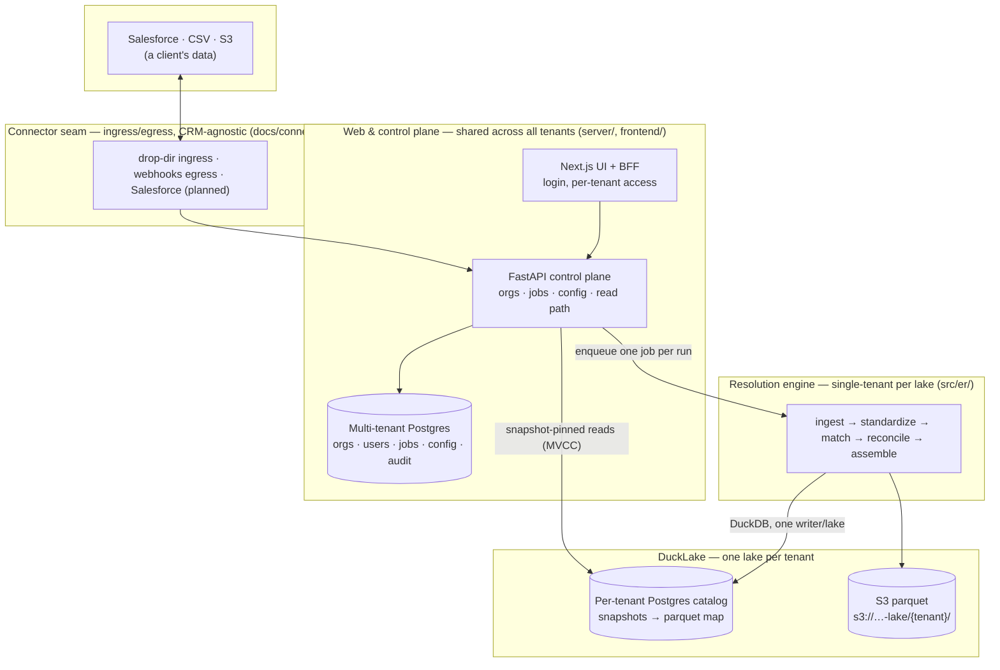

# Entity Resolution Engine

A multi-tenant SaaS that cleans customer data, finds duplicate records across
sources, and maintains a golden record for each resolved person. One shared web
application and control plane serve every tenant (a tenant is a client); each
tenant's data is resolved and stored in isolation. The long-term moat is a
source-agnostic resolution engine; the first market is Salesforce deduplication,
where it competes directly with [Cloudingo](docs/research-cloudingo.md).

The engine resolves:

- Standardized names, email addresses, phones, addresses and birth dates.
- Probabilistic matching (Fellegi–Sunter) with automatic-merge and manual-review thresholds.
- Persistent entity IDs, merge redirects, split history, deletions and resurrection.
- Golden records with configurable survivorship and attribute-level lineage.
- Full and incremental processing, steward assertions, run history and recovery.

## Architecture at a glance

The system is four layers. One shared web/control-plane layer oversees work for
every tenant; the heavy resolution runs per tenant in an isolated lake.



1. **Web & control plane** (`server/`, `frontend/`) — a single shared FastAPI
   control plane and Next.js UI/BFF. A login belongs to one or more tenants with a
   role; the BFF translates that membership into the right per-tenant credential on
   every request. Access is gated at the tenant level: a login sees the tenants it
   belongs to, and everything within them. A **multi-tenant Postgres** database
   holds the web/config state — orgs, users, memberships, jobs, config versions,
   schedules, webhooks, audit — so configuration is fast and centralized rather than
   per-tenant infrastructure.
2. **Resolution engine** (`src/er/`) — the batch pipeline, run as a library. It is
   single-tenant *per lake* and permits one writer at a time (a Postgres advisory
   lock). The product runs many such lakes behind the one control plane.
3. **DuckLake storage** (per tenant) — the big processing runs on
   [DuckLake](https://ducklake.select): a **dedicated Postgres catalog database per
   tenant** maps table snapshots to **parquet files in S3** under the tenant's own
   prefix. DuckDB executes the engine's generated SQL; snapshot/MVCC reads
   let the API serve point-in-time results without ever blocking the writer.
4. **Connectors** (`docs/connectors.md`) — a CRM-agnostic ingress/egress seam. The
   engine never learns about any specific source: connectors land deliveries as
   files and apply merge-backs through a small verb set. Drop-dir ingress and signed
   webhooks exist today; the Salesforce data connector (sync + writeback) is the
   first one being built.

**Tenancy, concretely:** a tenant = a dedicated catalog Postgres database
(`t_{org}_…`) + an S3 prefix, provisioned behind the shared control plane. It is a
namespace, not a row discriminator — no table carries a `tenant` column, and the
advisory writer lock is taken on the tenant's own database, so cross-tenant access
is structurally impossible rather than a per-query concern.

## Status

- **Built and tested:** the resolution engine (full + incremental, review,
  survivorship, golden records); the multi-tenant control plane in `server/` (jobs
  queue with per-tenant serialization, API-key auth + roles, versioned config with
  tiered publish, schedules, the snapshot-pinned read path, steward writes, drop-dir
  imports, signed webhooks, merge-plan export); and the web UI foundations in
  `frontend/`. See [backend design](docs/backend-design.md) and
  [frontend design](docs/frontend-design.md) for what each layer does.
- **In progress:** the Salesforce data connector (ingress + writeback,
  [connectors](docs/connectors.md)); human SSO (direct OIDC in the BFF); and the
  production AWS environment ([infrastructure](docs/infrastructure.md), tracked in
  [plan-to-aws](docs/plan-to-aws.md)). The dev cloud environment is built and
  live-probed; production is gated deliberately.

## Try the complete pipeline

The engine is a single Rust binary over a DuckLake directory — no services to
stand up. From the repository root:

```sh
cargo build -p er-cli --bin er
mkdir -p artifacts/demo
rust/target/debug/er \
  --catalog artifacts/demo/meta.ducklake --data-path artifacts/demo/data \
  --config configs/test.yaml \
  run-all \
  --drop fixtures/static/base_10/base \
  --lexicon rust/crates/er-cli/tests/fixtures/nickname_variants.csv \
  --model fixtures/static/model_test_v1.json \
  --tf fixtures/static/model_test_v1.tf.csv \
  --model-version v0001 --tf-snapshot-id tf0001 --run-id demo-run-1
```

This ingests the committed three-source fixture delivery, standardizes, scores
with the committed frozen model, reconciles entities and assembles golden
records — then `… doctor` prints the health report (latest run, per-relation
row counts). The lake is just the `artifacts/demo` directory; delete it to
start over. The [runbook](docs/runbook.md) covers training, incremental
deliveries, corrections and maintenance; `make dev-up` stands up the full dev
cloud stack (control plane + UI + per-developer lakes).

Training is explicit: `er run-all` runs ingest → standardize → match → reconcile →
assemble using an existing model. It does not train a model automatically.

## Performance

The Rust engine (`dedupe-core`) replaced the Python/Splink pipeline
bit-identically and runs the 1M-record workload faster on a flat memory
profile (~53% less at 8 threads than the Splink 5 baseline); DuckDB's thread
count is the main scaling lever. The retired Python stack's tuning record —
its 1M/10M medians, evidence-linked backlog and rejected experiments — is
preserved as history in the [performance record](docs/performance.md) and the
[profiling guide](docs/profiling.md), with the DuckLake analysis methodology in
the [analysis skill](.claude/skills/ducklake-performance/SKILL.md).

## Documentation

| Layer | Guide | Use it for |
|---|---|---|
| Product | [Backend design](docs/backend-design.md) | The multi-tenant control plane: orgs, jobs, config service, read path, isolation |
| Product | [Frontend design](docs/frontend-design.md) | Cloud UI: personas, access model, screens, BFF, phased plan |
| Product | [Connectors](docs/connectors.md) | The agnostic ingress/egress seam and the Salesforce connector |
| Product | [Cloudingo research](docs/research-cloudingo.md) | Competitor and market analysis driving the parity roadmap |
| Product | [DataGroomr teardown](docs/research-datagroomr.md) | Stack-ranked, Salesforce-free capability matrix of the second competitor, with the gaps a warehouse-native ER service can win on |
| Engine | [Architecture](docs/architecture.md) | Pipeline stages, data ownership and entity lifecycle |
| Engine | [Schema migrations research](docs/research-schema-migrations.md) | Atlas and Alembic against the entity framework's declarative model, and the proposal for per-tenant lake migration driven by the deploy |
| Engine | [ERD](docs/erd.md) | Generated entity-relationship diagram of every store (control plane, erweb, lake); regenerate with `er-entity gen` |
| Engine | [Technical specification](DesignDoc.md) | Numbered schemas, algorithms and invariants referenced by tests |
| Engine | [Configuration](docs/configuration.md) | Source mappings, matching rules, survivorship and runtime settings |
| Ops | [Runbook](docs/runbook.md) | Running the engine: initial load, deliveries, reviews, recovery, maintenance |
| Ops | [Performance](docs/performance.md) / [Profiling](docs/profiling.md) | Benchmark results, measured findings, traces and artifacts |
| Ops | [Infrastructure](docs/infrastructure.md) / [AWS plan](docs/plan-to-aws.md) | AWS/EKS design and the ordered build-out tracker |
| Contributing | [Contributing](CONTRIBUTING.md) | Local setup, tests and CI |

## Repository

`rust/` is the backend workspace — the resolution engine, the `er` pipeline
CLI and the multi-tenant control plane (`er-server`). `entities/` declares the
entity framework's table shapes (one YAML per table; `er-entity gen` renders the
committed Rust/DDL/TypeScript artifacts). `configs/` contains reference
configurations; `fixtures/` defines correctness checks; `frontend/` is the web
UI/BFF, a standalone pnpm project with its own lockfile (see
`frontend/README.md`). `docs/` holds the design docs and `infra/` the
Terraform/Helm build-out. Generated outputs belong in the ignored `artifacts/`
directory.

Licensed under [MIT](LICENSE).
