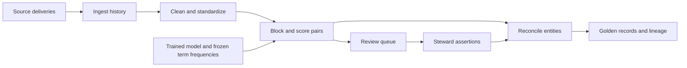

# Architecture

*Engine layer — single-tenant per lake. The multi-tenant platform that runs many
such lakes is in the [README](../README.md#architecture-at-a-glance) and
[backend-design.md](backend-design.md).*

The engine turns source records into a maintained set of people and golden
records. Each source record has a stable `source_system:source_record_id` key;
each resolved entity has a separate persistent identifier.

## Pipeline and storage

| Stage | Work | Main outputs |
|---|---|---|
| Ingest | Map source columns, detect changed content and append versions | `raw_records`, `ingest_batches` |
| Standardize | Normalize values and select current record versions | `int_std_records` |
| Train | Fit the match model (Fellegi–Sunter) and freeze term frequencies | model JSON + TF snapshot CSV artifacts |
| Match | Score candidates with a selected model and queue uncertain pairs | `match_scores`, `review_queue` |
| Reconcile | Apply assertions, cluster records and preserve entity identity | `entities`, `entity_membership`, `entity_events` |
| Assemble | Select winning values and record their source | `golden_records`, `golden_lineage` |

DuckLake stores data in S3-compatible storage (a plain directory in local
development) and metadata in PostgreSQL or a catalog file. DuckDB executes the
SQL the engine generates for staging, standardization, blocking, scoring and
golden assembly; the Rust engine orchestrates ingestion, the model lifecycle,
reconciliation and every operational write — id minting (`er-ids`), content
hashing (`er-hash`) and graph clustering (`er-reconcile`) run in Rust.
Logical keys are enforced by writers and tests because DuckLake does not enforce
primary-key or unique constraints.

The [specification's data model](../DesignDoc.md#s5) is the normative table
inventory; in code, the registry in
[rust/crates/er-schema/src/model.rs](../rust/crates/er-schema/src/model.rs) and
the entity catalog under [entities/](../entities/) are the authorities (the
generated [ERD](erd.md) draws all of it).

## Identity and golden records

An unchanged membership partition retains its entity ID. Merges select a survivor
and leave redirects for losing entities. Splits select the fragment that retains
the old ID and mint IDs for other fragments using deterministic ordering.
`entity_events` records the changes; identifiers alone are not a similarity score.

Golden values follow the configured survivorship ordering: validation, source
priority, recency, frequency or completeness. Address fields survive as one
component group. `golden_lineage` records the winning source and rule for each
attribute (display formatting is client-side, over the raw golden columns). Merged
or retired entities
are removed from the current golden output.

## Incremental processing and review

Incremental matching scores new or changed records against the corpus and against
each other. Reconciliation expands the affected records to whole existing entities
and relevant current edges. Assembly rewrites the touched entities.

Scores depend on the chosen model and frozen term-frequency snapshot. Configuration
or model drift can require a full run. Incremental/full equivalence has explicit
preconditions; `er correct` refreshes term frequencies and performs a full rescore,
reconciliation and assembly without retraining. See
[INV-EQ](../DesignDoc.md#s4-5) for the precise guarantee.

Review decisions become persistent `always` or `never` assertions. Contradictory
assertions fail explicitly. The reconciliation policy enforces `never` constraints
across transitive connections, not just the directly scored pair.

## Execution boundaries

A PostgreSQL advisory lock permits one writer per tenant. Native DuckDB connections
are reused within a command and closed between stages. `runs` records each run's
configuration fingerprints, status and snapshot range. A failed job is resumed
through the control plane (`resume` re-queues it); runs are deterministic over
their pinned inputs, so a resumed run reproduces, never approximates.

The engine itself has no serving API or built-in scheduler; the control plane in
[server/](backend-design.md) provides both, driving the engine per run —
including periodic correction and maintenance. Coherence scoring currently
uses `NoopScorer`; the interface exists for a future implementation.

See the [runbook](runbook.md) for commands and the
[specification](../DesignDoc.md) for algorithms and schemas.
