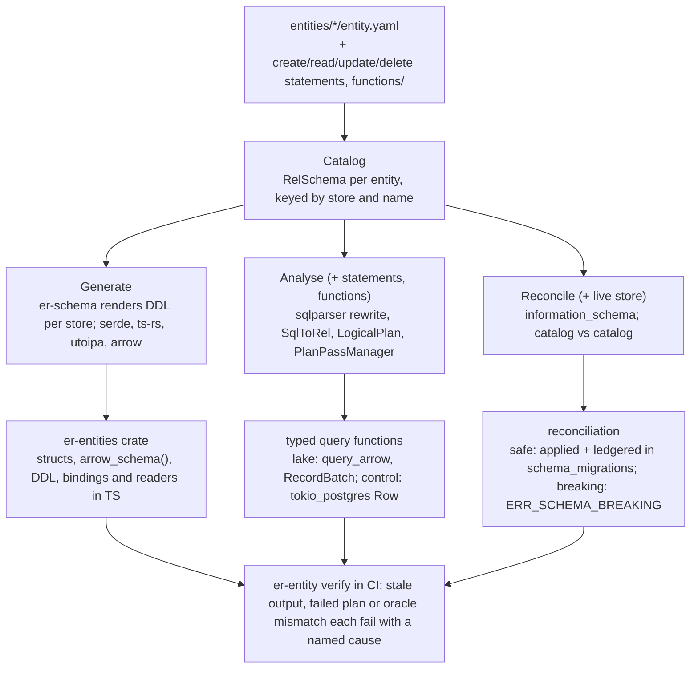
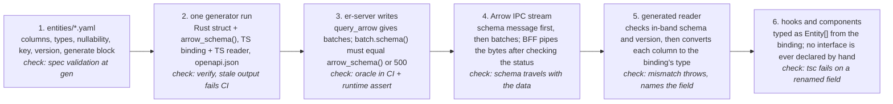
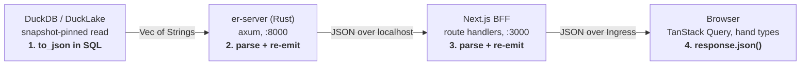

# Entity Framework Design

Status: design, 2026-10-16. Companion to `docs/backend-design.md` and `docs/frontend-design.md`. The living copy with diagrams and comments is the "Entity Framework Design" document in Claude Docs; this file is its export, kept in the repo so the design travels with the code.

**Part 1** is the design: what the framework is and how it works. **Part 2** is the background and the research that led to it. **Part 3** is the build plan, the risks and the open questions.

## Part 1: Design

### What it is

The entity framework turns one YAML file per table into everything else that has to agree with that table: the Rust struct, the DuckLake or Postgres DDL, the Arrow schema the read API streams, the TypeScript type the browser uses, and a typed Rust function for every SQL statement the product runs. It does this with a generator and a static analyser that share one in-memory catalog. The generator writes files; the analyser plans SQL against the catalog with DataFusion and refuses statements that do not fit. A differ compares the catalog to a live database and emits a migration plan or a refusal. Because every reader in every language is generated from the same file, tabular data crosses the wire as Arrow IPC and nothing parses JSON.

The one rule: no schema and no SQL is hand-written outside `entities/` and `functions/`. If a type, a column list, a DDL statement or a query string appears anywhere else in the repo, it was generated, and `er-entity verify` in CI will say so when it is stale.

It is built for this repo only. There is one type vocabulary, two stores, one dialect each, and no plugin surface. Where a general tool would add configuration, this one adds a fixed decision, listed near the end. It is not a transformation tool and not feather-flow: it owns no DAG and materializes nothing. Entities are tables the product reads and writes, and the SQL under analysis is application SQL, not transformations. The background, the research that led here and the build plan are Parts 2 and 3.

### The flow



The catalog is the only thing the three consumers share. Generation never reads SQL, analysis never writes DDL, and the reconciler reads neither, so each can be tested alone against the same catalog value. The reconciler is the one consumer that also runs in production: the catalog is compiled into `er-server` (`er_entities::catalog`), and every store is reconciled to it at the moments described under Upgrades.

### Definition first: how a change is made

Code is written after generation, against generated definitions, never before. A type, a column list, a query shape or a DDL statement never originates in hand-written code; it originates in `entities/` or `sql/`, the generator turns it into code, and then people write the code that uses it. This is the order every change follows:

1. **Change the definition.** Edit or add an entity's `entity.yaml`, or a statement under the entity's `create`, `read`, `update` or `delete` folder, or a function under `functions/`. Nothing else is touched yet. For a new column that is one line of YAML; for a new read that is one `.sql` file and its `.yaml` beside it.
2. **Generate.** Run `er-entity gen` and `er-entity check`. The generated artifacts appear in the working tree as a reviewable diff: the Rust struct and its `arrow_schema()`, the lake or Postgres migration file, the TypeScript binding and reader, the typed query function for each statement. If a statement does not plan, this step fails with the diagnostic and nothing downstream is written.
3. **Write the Rust.** Handlers, dispatcher code and engine stages are written against the generated struct and the generated query function. A handler calls `golden_list(session, snapshot, after, q, limit)` and gets `RecordBatch` values whose schema is already asserted; a dispatcher step calls `jobs_claim(client, org)` and gets `Job` values. There is no place in this code to spell a column name.
4. **Write the frontend.** Hooks, components, BFF route handlers and mock fixtures are written against `bindings/<Entity>.ts`, `readers/<Entity>.ts` and the typed routes in `schema.d.ts`. A component renders `GoldenRecord` fields the compiler knows; it never declares an interface.
5. **Commit together, verify in CI.** The definition change, the generated diff and the hand-written code land in one PR. `er-entity verify` proves the generated tree is current and every statement plans and matches the real databases; `pnpm check` proves every TypeScript call site compiles against the new shapes.

**A concrete change: adding `middle_name` to the golden record.** One line in `entities/golden_record.yaml`. `er-entity gen` adds the field to `GoldenRecord` in Rust, a nullable `Utf8` to `arrow_schema()`, a lake migration with `ALTER TABLE ADD COLUMN`, `middle_name: string | null` to the binding, and a column conversion to the reader. `er-entity check` re-plans every statement: `golden_list.sql` names its columns and does not yet select the new one, so it still passes, and E003 reports that its output no longer equals the entity, which is the prompt to add the column to the statement. The survivorship stage's statement is updated to produce it. The records browser component is updated to show it, against a field the compiler already knows. Nothing in that sequence involved typing a column name into Rust or TypeScript by hand, and the first time the new column reaches a browser, every hop between the lake and the screen has already been checked against the same definition.

### The catalog

An entity file names a table, lists its columns with a type and a nullability, names its key, carries a description for the table and each column, and says what to generate for it. The `generate` block has three lists: `stores`, any of `duckdb` and `postgres`, which decide which DDL is rendered and which catalogs the entity joins; `languages`, any of `rust` and `typescript` (with room for `python` later), which decide which readers are emitted; and `wire`, any of `arrow` and `json`, which decide whether `arrow_schema()` and the OpenAPI schema are emitted. A backend-only table generates for one store and `rust` alone; a table the UI reads generates for its store, both languages and both wires. Defaults are deliberate and loud: an entity with no `generate` block is a spec error, not a guess.

```yaml
# entities/golden_record.yaml
kind: entity
version: 1
name: golden_record
relation: golden_records
description: "One resolved person: the surviving value per attribute."
key: [entity_id]
generate:
  stores: [duckdb]
  languages: [rust, typescript]
  wire: [arrow, json]
columns:
  - name: entity_id
    type: varchar
    nullable: false
    description: "Persistent entity id (deterministic UUIDv7)."
  - name: given_name
    type: varchar
    description: "Surviving given name."
  # ... the other survivable columns ...
  - name: birth_date
    type: date
    description: "Surviving birth date."
  - name: survivorship_version
    type: bigint
    nullable: false
    description: "Survivorship policy version that produced this row."
  - name: assembled_at
    type: timestamp
    nullable: false
    volatile: true              # excluded from determinism comparisons
    description: "Assembly time of this row."
```

Control entities on `postgres` may also carry `default`, `references`, `accepted_values` and `indexes` (including partial unique indexes with a `where`); `duckdb` entities may not, because DuckLake enforces nothing but `NOT NULL` and the lake registry has always said so. Every `duckdb` entity is created by the engine from the generated DDL; there is no second owner. An entity may list both stores when the same shape genuinely lives in both; each store then gets its own DDL from the one column list, and the entity appears in both catalogs for the analyser.

The type set is the eight types `er-schema::model` already permits: `VARCHAR`, `BIGINT`, `DOUBLE`, `BOOLEAN`, `DATE`, `TIMESTAMP`, `JSON`, `LIST(VARCHAR)`. They are the intersection of what DuckLake, Postgres, Arrow, serde and TypeScript all carry without loss. A ninth type is a spec error, not a mapping to add.

Loading produces the catalog: every entity becomes an `ff_analysis::RelSchema` of `TypedColumn` values, each with an `ff_analysis::SqlType` and a `Nullability`, keyed by its store-qualified name (`lake.main.golden_records`, `public.jobs`). These are feather-flow's own types, unchanged, so the analyser consumes the catalog with no translation. The eight entity types map onto a fixed subset of `SqlType`; the rest of `SqlType` (decimal, uuid, struct, map) remains available for intermediate expressions inside a statement and can never be a column.

The catalog is also what `er-schema` renders DDL from. Its `TableSpec` and `Column` values, which are built by hand today, are built from the catalog instead, so `create_table_sql` keeps working as it is.

### Identity conventions

Every entity has the same identity shape, validated at catalog load (the V rules) and at statement analysis (E005/E014/E015):

- **`id` is the primary key, always.** `key: [id]` exactly; `id` is `varchar`, `NOT NULL`, and the first declared column. How an id is *minted* depends on who creates the row: application-minted rows carry a **UUIDv7** (canonical lowercase text; `er_ids::new_v7()` for one-shot mints, `er_ids::deterministic_v7(logical_ts, counter)` where reruns must be byte-identical), SQL/CTAS-minted rows carry a **content-derived sha256** (`sha256('<relation>:' || k1 || ':' || …)`, 64 hex chars — `er_ids::natural_id` is the Rust twin), and database-minted ledgers (`audit_log`, `ddl_log`) are the one exception: `bigint` with `serial: true`, because a trigger cannot mint a v7. There is deliberately no ninth `uuid` column type — ids are text.
- **`natural_key` declares what makes two rows the same thing** — the upsert/MERGE identity, distinct from the primary key. On the lake it is published as a second registry `LogicalKey` (and the ERD's implied edges are drawn from it); on the control plane it renders as `UNIQUE (…)`. Natural-key columns are real and never the universal columns (nullable is allowed — a MERGE identity can be partial, like review_queue's pair keys on entity-subject rows).
- **`created_at` and `updated_at` on every entity**, `timestamp NOT NULL`. Control-plane timestamps are wall-clock: `default: now()` and `volatile: true`. Lake timestamps are **run-logical** — written by statements from the run's logical clock, part of the determinism contract, never volatile, never defaulted.
- **Foreign keys are named for what they point at**: `<singular(relation)>_id`, optionally `<role>_` prefixed (`org_id`, `source_org_id`), and always reference `id`. Reference targets are validated against the catalog.
- **`history: true` generates a row-image ledger.** A control-plane entity may opt into a `<relation>_history` companion (generated DDL, not an entity): `history_id bigserial`, `row_id` (the entity's `id`), `op` (insert/update/delete), `changed_at`, `actor`, and whole-row `old_row`/`new_row` jsonb images, written by one generic `public.er_history()` trigger function (the baseline's entry 0) parameterized by `TG_ARGV[0]`. Schema-evolution-proof — the trigger names no entity columns, so ADD/DROP/ALTER COLUMN never breaks it and old images keep dropped values. The actor comes from the `er.actor` GUC (handlers declare the principal; the dispatcher declares itself) with a `session_user` fallback, and the trigger is deliberately NOT exception-swallowed: if history cannot be written, the write fails. Lake entities refuse the flag — lake history is DuckLake snapshots. Flagged today: org, api_key, config_version, schedule, webhook (not job — claim/heartbeat churn).
- **Domain linkage columns keep their names.** Only primary-key columns renamed to `id`; a column that *stores* another entity's id keeps its descriptive name everywhere (`record_key`, `rec_a_key`/`rec_b_key`, `entity_id` as an FK on membership/lineage, `run_id`, `master_key`).

**The V rules are no longer listed here.** They live in `er-entity-lint` as a
registry of rule values, each carrying its own code, title, reasoning and a
worked conforming/violating example pair, and
**[`docs/entity-lint-rules.md`](entity-lint-rules.md) is generated from that
registry** by `er-entity lint --docs`. `er-entity verify` byte-compares the
committed file against the registry, so the reference cannot drift from what is
enforced — which is exactly how `E007`/`E008`/`E013` below came to be documented
but never implemented. `er-entity lint --list` is the same table at the terminal
and `er-entity lint --explain V4` prints one rule in full.

What is worth recording here is the shape rather than the list: V1–V8 are the
identity conventions above, V9–V10 the cross-tree and natural-key ones, V11–V13
what each store will actually honour, V14 the history-companion name, and V15 the
first rule at `Severity::Warning` — a severity the previous fail-fast design could
not express, so a rule was either absent or it blocked every command in the repo.
All the error-severity rules are unconditional: the identity retrofit completed
and the temporary `identity: legacy` ratchet field was deleted with its last
marker.

Two consequences of the registry living outside `er-entity-spec`. `Catalog::load_dir`
now checks only what makes a catalog *structurally* coherent (a duplicate column
name, a key naming no column); anything about to write a generated artifact loads
through `er_entity_lint::load_linted` instead, as every `er-entity` subcommand
does. And the pass **collects every violation** rather than returning the first,
so a new entity converges in one run instead of one error per run.

### Generation

The generator reads the catalog and nothing else. For each entity it writes only what the entity's `generate` block asks for: a Rust module into the `er-entities` crate when `rust` is listed, a TypeScript binding and reader when `typescript` is listed, DDL per listed store, and the Arrow and OpenAPI schemas per listed wire. Output is committed, formatted deterministically, and reviewed as a diff beside the YAML change that caused it. Two consistency rules are checked at generation time rather than left to convention: a wire implies the languages on both ends of it (`arrow` and `json` each require `rust`, and require `typescript` when any read statement whose yaml returns the entity belongs to the read API), and a statement's store must be one of the entity's stores for every entity it references.

| Target | What is written | Done by |
|---|---|---|
| Rust struct | one struct per entity with the mapped field types and `Option` for nullable columns; `serde::Serialize` and `Deserialize`, `ts_rs::TS` with export, `utoipa::ToSchema`; a `KEY` constant; a `columns()` function returning the declaration-ordered names; an `arrow_schema()` function | the generator's Rust emitter, text templates |
| DuckLake DDL | `CREATE TABLE IF NOT EXISTS lake.main.*` for every `duckdb` entity, one reviewable file per relation; the reconciler renders the same DDL from the compiled-in catalog when it creates a tenant's tables | `er_schema::model::create_table_sql`, fed from the catalog |
| Postgres DDL | one file per `public.*` relation: tables, primary keys, defaults, references, check constraints for accepted values, partial unique indexes, the history companion; plus `POSTGRES_BASELINE`, every relation's DDL in FK order, which boot replays | a Postgres emitter in the generator |
| Compiled-in catalog | `er_entities::catalog::catalog()`: every `entity.yaml` embedded with `include_str!` and parsed on demand, so the reconciler compares a live store with the committed definitions without YAML on disk | the generator's catalog emitter |
| Arrow | the body of `arrow_schema()`: one `arrow::datatypes::Field` per column, the entity's key, store and version as schema metadata; lake timestamps as `Timestamp(Microsecond, None)`, which is what DuckDB returns | the same type map, written as Rust source |
| TypeScript binding | `bindings/<Entity>.ts` with the ts-rs mapping; `i64` as `number`, dates and timestamps as ISO strings, JSON as `unknown` | `ts_rs` export, run as a test of `er-entities` |
| TypeScript reader | `readers/<Entity>.ts`: a function from an `apache-arrow` `Table` to `Entity[]`. It first checks the stream's in-band schema against the entity: a type mismatch, a missing `NOT NULL` column or a different `er.schema_version` throws naming the field; a missing nullable column reads as `null` and an unknown extra column is ignored, so old and new bundles tolerate each other across a deploy in both directions. It then converts each column from its Arrow vector to the binding's type (Int64 to `number` with a range check, Date32 and Timestamp to ISO strings, List to arrays, Utf8 JSON columns left as text) | the generator's TypeScript emitter, from the same type map |
| OpenAPI | nothing directly; `er-server`'s utoipa document references the generated structs' `ToSchema`, so `openapi.json` follows the entity | `utoipa` in `er-server` |

The type map is one table, applied in every emitter: entity type to Rust type, to DuckLake, to Postgres, to Arrow `DataType`, to TypeScript, with a store column where the stores differ.

| Entity type | Rust | DuckLake | Postgres | Arrow | TypeScript |
|---|---|---|---|---|---|
| `varchar` | `String` | `VARCHAR` | `text` | `Utf8` | `string` |
| `bigint` | `i64` | `BIGINT` | `bigint` | `Int64` | `number` (reader range-checks) |
| `double` | `f64` | `DOUBLE` | `double precision` | `Float64` | `number` |
| `boolean` | `bool` | `BOOLEAN` | `boolean` | `Boolean` | `boolean` |
| `date` | `NaiveDate` | `DATE` | `date` | `Date32` | `string` (ISO date) |
| `timestamp` | `DateTime<Utc>` | `TIMESTAMP`, UTC by convention, tagged at the boundary | `timestamptz` | `Timestamp(Microsecond, None)` on the lake; never crosses Arrow from postgres | `string` (ISO) |
| `json` | `serde_json::Value` | `JSON` | `jsonb` | `Utf8` with `er.json` metadata | `unknown` |
| `list<varchar>` | `Vec<String>` | `LIST(VARCHAR)` | `text[]` | `List(Utf8)` | `string[]` |
| nullable | `Option<T>` | nullable | nullable | nullable | `T \| null` |

The one row where the stores differ is `timestamp`. Rust uses one type, DateTime<Utc>, for both stores so that an entity listing both stores has one struct; the lake stores naive UTC and the generated lake function tags it at the boundary, Postgres stores timestamptz. Both serialize to the same ISO string in JSON and in the TypeScript reader. The map lives in the generator and nowhere else; the analyser's oracle is what proves the map matches what the databases actually return.

### Generated readers, binary wire

The point of generating the types in every language is that the data never has to be parsed. A reader that was generated from the entity knows the columns, their order, their types and their nullability before a byte arrives, so the wire can carry Arrow IPC and the reader can use it in place. JSON exists in this system only because readers were hand-written and had to be told the shape at runtime; once every reader is generated, that reason is gone.

| Reader | Language | Generated from the entity | What it reads |
|---|---|---|---|
| `er-server` handlers and the dispatcher | Rust | the `er-entities` struct, `arrow_schema()`, and the typed query functions | `RecordBatch` from DuckDB, `Row` from Postgres |
| the engine's stage crates | Rust | the same struct and the ordered column constants | `RecordBatch` from DuckDB |
| the Next.js BFF | TypeScript | `bindings/<Entity>.ts` | nothing on the data lane: it forwards the Arrow body as a stream; on the control lane, generated types through `schema.d.ts` |
| the browser | TypeScript | `bindings/<Entity>.ts` and `readers/<Entity>.ts` | the Arrow IPC stream through `tableFromIPC` and the generated reader, which yields the binding's exact shape |
| the assistant's tool layer | TypeScript | the same binding and reader | the same Arrow stream, decoded once in the BFF for the model's text |
| any future consumer (a Python notebook, a partner SDK) | its own | a new emitter in the generator, from the same catalog, switched on per entity in `generate.languages` | the same Arrow stream; never a JSON fallback |

Three things make this safe rather than hopeful. The Arrow IPC stream carries its schema in-band, so a reader can confirm the stream is the entity it expects before touching a value. The Rust side asserts every batch against `arrow_schema()` before writing, so a stream that reaches a reader is by construction the declared shape. And every reader's type was emitted from the same catalog in the same generator run, so a column added in YAML appears in all of them in one commit, and a column removed breaks each reader at its own build, not at a customer's screen.

What stays JSON: commands and their responses on the control lane (submit a job, publish a config, resolve a review) and the error envelope. Those bodies are also generated types, serde on one side and the ts-rs binding on the other, so even there nothing is parsed by hand; they are small objects where an IPC stream's schema message would cost more than the payload. Every tabular read and every export is binary.

### The frontend contract

The frontend never defines a shape. For every entity with `typescript` in its `generate` block it receives three generated files and uses nothing else: `bindings/<Entity>.ts`, the type; `readers/<Entity>.ts`, the function that turns an Arrow `Table` into `Entity[]`; and the entity's component schema inside `schema.d.ts`, which types the control-lane routes through `openapi-fetch`. A data-lane hook is `arrowFetch(path)` returning `{ rows: Entity[], snapshot, nextCursor }`, where `rows` came through the reader. A control-lane hook is the existing typed client. Components, BFF route handlers and mock fixtures import these; an `interface` keyword in frontend code that describes server data is a review failure.



**Why what arrives is the type it claims to be.** Each link in the chain has one thing that could go wrong and one check that catches it.

| Link | What could go wrong | What guarantees it |
|---|---|---|
| YAML to the four artifacts | the Rust struct, `arrow_schema()`, the binding and the reader describe different columns | they are emitted from one catalog in one generator run; `er-entity verify` fails CI if any is stale |
| DuckDB to the Rust side | the database returns a type or column the struct did not expect | the oracle compares every statement's `DESCRIBE` result with the plan in CI; at runtime the handler asserts `batch.schema()` equals `arrow_schema()` before writing a byte, and answers 500 otherwise |
| server to browser | bytes are altered or re-shaped in transit | the IPC stream carries its schema in its first message; the BFF checks the status, then pipes the body untouched |
| bytes to the reader | an old bundle meets a new server, or a new bundle meets a rolled-back server, in a tab that was open through the deploy | the generated reader compares the in-band schema with its own expectation before decoding: a type mismatch, a missing `NOT NULL` column or a different `er.schema_version` throws naming the field; a missing nullable column reads as `null` and an extra column is ignored, which is what additive compatibility means on the wire |
| Arrow vectors to TypeScript values | Int64 arrives as `bigint`, Date32 as a day count, Timestamp as a number, while the binding says `number` and ISO strings | the reader converts every column by the type map, so Arrow and JSON yield the identical binding shape |
| reader to components | a field is renamed or removed in YAML and a component still uses it | the binding changed in the same generator run; `tsc` fails at every call site in `pnpm check` |
| the JSON control lane | the server's JSON disagrees with `schema.d.ts` | the same struct is serialized by serde and described by utoipa's `ToSchema`; a Rust snapshot test pins `openapi.json`, `openapi-typescript --check` pins `schema.d.ts`, and Schemathesis proves the live server honours the document |
| test doubles | the mock server drifts from the real shape and the functional tier passes against fiction | fixtures are built as the binding type and emitted with `tableToIPC`, so the functional tier runs the real readers; the nightly full-stack tier runs real traffic through a spec-validating proxy. Neither Prism nor Schemathesis can validate an Arrow body, only its status and content type, so for the data lane the reader's own schema check is the body validation, exercised in both tiers |

Two things are deliberately not done. There is no runtime schema validation of JSON bodies in production, because the control lane's types are guaranteed by generation and by the two CI checks on the document, and a validator would be a second copy of the same contract. And nothing is guaranteed by convention: every row in the table above is a test, an assertion or a compiler error, never a code review note.

### Statements and functions on disk

Every entity is a folder, every statement lives under its entity in a folder named for its operation, and every statement has a YAML beside it that the analyser reads. Functions have their own tree, one YAML per function, whether the body is ours or the function is baked into the database. The result is that every type the product touches, in a table, a parameter, a result or a function signature, is declared in a file in the repo.

```
entities/
  golden_record/
    entity.yaml                 # the table: columns, key, generate block
    create/
      assemble.sql              # the survivorship stage's INSERT ... SELECT
      assemble.yaml
    read/
      list_page.sql             # the records browser's keyset page
      list_page.yaml
      by_id.sql
      by_id.yaml
    update/
    delete/
      purge_entity.sql
      purge_entity.yaml
  job/
    entity.yaml
    create/  read/  update/  delete/
      claim.sql                 # update: FOR UPDATE SKIP LOCKED ... RETURNING
      claim.yaml
functions/
  duckdb/
    phone_e164.yaml             # ours: deployed as a macro at job start
    phone_e164.sql
    builtin/
      coalesce.yaml             # baked in: a typed stub, no body
      ilike.yaml
      list_contains.yaml
  postgres/
    builtin/
      now.yaml
      jsonb_build_object.yaml
```

**The statement YAML** is small and mandatory. It names the operation, which must match the folder; the parameters with their types from the entity vocabulary and whether each is nullable; what the statement returns (`entity`, a named column list, or `none` for a write); the planning mode (`full` by default, `partial` only when declared); and a description, which is required because this tree is also the documentation of every query the product runs. A statement that reads several entities (the duplicates list joins `golden_records` to `entity_membership`; the dashboard counts across four tables) lives under the entity it returns, or, when it returns a bespoke column list, under the entity of its primary `FROM` table, and its yaml names every other entity it reads under `reads:` so E009 and the differ's impact report know the full set without parsing the SQL twice. A screen that needs several row sets, such as the entity detail page, is several statements under their own entities, composed by the handler; there is no multi-result statement.

```yaml
# entities/golden_record/read/list_page.yaml
kind: statement
operation: read
description: "One keyset page of golden records at a pinned snapshot, optionally filtered by name or email."
params:
  - { name: snapshot, type: bigint }
  - { name: after,    type: varchar, nullable: true }
  - { name: q,        type: varchar, nullable: true }
  - { name: limit,    type: bigint }
returns: entity
```

A bespoke-shape read declares its columns **typed** — a name alone cannot type the generated row. Result columns default nullable (the opposite of params): neither database reports result nullability, so non-`Option` is an opt-in claim the analyser must prove against the plan and the generated conversion enforces at runtime.

```yaml
# entities/entity_membership/read/member_keys.yaml
kind: statement
operation: read
description: "The member record keys of one entity at a pinned snapshot, ascending."
params:
  - { name: snapshot, type: bigint }
  - { name: entity_id, type: varchar }
returns:
  - { name: record_key, type: varchar, nullable: false }
```

A lake read is snapshot-pinned by default (E006). The writer's own in-transaction reads — er-cli composing a run, or an endpoint documented to read live — declare `pin: live` with a mandatory `pin_reason`; the justification lives in the reviewed yaml diff, and E006 then forbids a stray `AT (VERSION => ..)` instead. `pin:` means nothing outside a lake read and is rejected elsewhere.

**The folders are checked, not just tidy.** A pass (E012) refuses a statement whose kind does not match its folder: `read` holds `SELECT` and `COPY ... TO`; `create` holds `INSERT`, including `INSERT ... ON CONFLICT DO UPDATE` (an upsert is filed by its leading verb), `COPY ... FROM`, and a `MERGE` that inserts; `update` holds `UPDATE` and a `MERGE` that only updates; `delete` holds `DELETE`. E006, the pinned-snapshot rule, applies to the `read` folder of lake entities, which is the read API's surface; `create` and `update` statements are the engine's and run against the job's working state under the writer lock. The generated Rust function is namespaced the same way, `golden_record::read::list_page`, so a call site reads as what it does to which table.

**Functions** use feather-flow's `kind: function` format unchanged. A function of ours has a YAML (name, typed arguments, scalar return type or table columns) and a `.sql` body that the engine deploys as a DuckDB macro at job start. A built-in has the same YAML with `builtin: true` and no body; it exists so the analyser has a typed signature for it, and the YAML is the one place that signature is written. Every function a statement calls must have a YAML (E013); an unknown function is a named error, never a guess. The hard-coded stub set in feather-flow's `datafusion_bridge::functions` is replaced by this folder. The Postgres tree holds built-in stubs only; the control plane defines no SQL functions of its own, and adding one would be a deliberate change with a body file beside its YAML like the DuckDB ones.

**Built-in stubs are proven against the database.** A stub can lie, so the oracle covers them: for each built-in YAML, CI asks the real engine for the function's return type with the declared argument types (DuckDB through `typeof()` on a literal call, Postgres through `pg_proc` and `pg_get_function_result`) and fails on a mismatch. Variadic and overloaded built-ins declare each overload the application uses as a separate signature in the same YAML.

**What the layout gives beyond the checks.** The `create`, `read`, `update` and `delete` folders of an entity are the complete, reviewable list of everything the product does to that table. The differ's impact report points into them by path. A new engineer reading `entities/job/` sees the table, every way a job is created, read, claimed and finished, and the types of every parameter, without opening Rust.

### Static analysis

Every statement the product runs is a file under its entity's `create`, `read`, `update` or `delete` folder, one statement per file, with a `.yaml` beside it that names its operation, its parameters and types and what it returns (the layout is in Statements and functions on disk). The analyser takes each file through four steps and produces either a typed Rust function or a diagnostic. This is what sqlx does with a live database; here the catalog is the database.

**Rewrite.** A `sqlparser` visitor handles what DataFusion cannot plan, and there is more of it than the lake alone would suggest. DuckLake's `AT (VERSION => $snapshot)` clause is removed and recorded as the statement's required snapshot parameter. A `MERGE INTO` is split: its source query goes on to planning, and its target assignments are checked by column name and type against the entity directly. On the control store, `RETURNING` is removed and its output schema is taken from the entity's columns; `ON CONFLICT ... DO NOTHING` and `DO UPDATE SET` are removed after their assignment lists are checked like an update's; `FOR UPDATE`, `SKIP LOCKED` and `NOWAIT` are removed as having no effect on the plan's schema; `::jsonb` and `::text` casts stay, since DataFusion plans casts. Named parameters become positional placeholders carrying their declared types. A statement that still does not plan after the rewrite is declared `partial` in its yaml. Partial means the PLANNER is skipped, not the parser: a partial statement that sqlparser can read (every committed MERGE, ON-CONFLICT write and DuckDB-only read) still gets the full AST passes — E004, E005, E010, E011 and E012 — and only a truly unparseable statement falls back to the text heuristics. Parameters are typed from the yaml alone (E002 by text), and the oracle below supplies the output schema. Partial mode is the exception the yaml makes visible, not a silent fallback.

**Plan.** `datafusion_sql::planner::SqlToRel` plans the statement with the store's dialect (`DuckDbDialect` or `PostgreSqlDialect`) and a `ContextProvider` over the catalog restricted to that store. This is feather-flow's `FeatherFlowProvider` with a store-qualified lookup. Tables resolve to the catalog's `RelSchema`; our DuckDB macros resolve through `UserFunctionStub` and `UserTableFunctionStub` from their `kind: function` files; built-ins resolve through the typed stubs declared under `functions/*/builtin`, one yaml per built-in the application SQL uses. A function with no yaml is a named error, never a guess. The result is a `datafusion_expr::LogicalPlan`: a projection for reads, `Dml` for insert, update and delete, `Copy` for exports. Parameter types come from DataFusion's placeholder inference and are checked against the yaml.

**Pass.** feather-flow's `PlanPassManager` runs its existing per-plan passes (type inference, nullability through joins, join keys) plus the entity passes, each a `PlanPass` with a code and a severity:

| Code | Statements | Check |
|---|---|---|
| E001 | all | every table and column resolves in the declared store's catalog |
| E002 | all | every `$param` is declared in the yaml with a type compatible with the planner's inferred placeholder type; a lake statement may not declare a `list<varchar>` param (duckdb-rs has no LIST binding) — the lake idiom is a `chr(31)`-delimited varchar split with `string_split($p, chr(31))` |
| E003 | reads | the output equals the declaration — the named entity (`returns: entity`) or the typed column list (`returns: columns`): same columns, same order, compatible types, nullability no looser than declared |
| E004 | INSERT (incl. a MERGE's insert arm) | every `NOT NULL` column without a `default` (or serial) is supplied — named columns as a set, a positional insert by arity; value compatibility is the planner's/oracle's half |
| E005 | UPDATE, MERGE | every assigned column exists on the entity, and a `key` column is never assigned (identity is never rewritten); the immutables extend to the `natural_key` columns and `created_at` (written once, at insert); type compatibility is the planner's/oracle's half |
| E006 | lake `read` folder | the statement carries `AT (VERSION => $snapshot)` unless it declares `pin: live` with a `pin_reason` (the writer's own in-transaction reads); a live read must then NOT carry a pin, and `pin:` outside a lake read is rejected; engine `create` and `update` statements are exempt because they are the writer |
| E007 | DELETE, UPDATE | a `WHERE` clause is present on a control table |
| E008 | COPY TO | the source query plans and the target format is parquet or csv |
| E009 | all (AST; subquery-complete via the sqlparser visitor) | every qualified relation reference resolves to an entity of the statement's own store, and every entity beyond the statement's own is named under `reads:` (a `reads:` entry must itself name a same-store entity); unqualified names are session temps/CTEs, governed elsewhere |
| E010 | all | a string literal meeting an `accepted_values` column — compared in a predicate, assigned, or inserted — is in the set |
| E011 | all, no override | no `SELECT *` anywhere: projections, subqueries, CTEs, `INSERT ... SELECT`, `COPY TO`; every column is named, so an added column can never change a statement's shape |
| E012 | all, no override | the statement's kind matches its folder, per the table in Statements and functions on disk |
| E013 | all, no override | every function the statement calls has a yaml under `functions/`, ours with a body or a built-in stub, with a signature the arguments satisfy |
| E014 | UPDATE, MERGE matched-update, ON CONFLICT DO UPDATE | a mutation that rewrites a row assigns `updated_at` |
| E015 | MERGE | the ON clause's target-side column set equals the declared `natural_key` (or `[id]` when none is declared) — the upsert identity lives in the entity file, not ad hoc per statement |

**Emit.** For each statement that passes, the generator writes one Rust function into `er-entities`, namespaced by entity and operation (`golden_record::read::list_page`): typed arguments from the yaml, and a return type that is either the named entity's struct or a bespoke row struct built from the **declared** typed column list (the emitter is plan-free; the analyser proves the declaration against the plan, E003). A `returns: entity` lake read runs through `duckdb::Statement::query_arrow` and returns `arrow::record_batch::RecordBatch` — the Arrow-wire path. A `returns: columns` lake read emits `<Name>Row`: typed serde-serializable fields (`Option` exactly when declared nullable), the declared result schema compiled in as `expected_fields()`, and a `from_batches` conversion through the generated `er_entities::batch` support module that answers any shape, type or null violation with an `Err`, never a panic; `json` columns cross Arrow as text and are parsed into `serde_json::Value`, so handlers serialize rows with correct JSON nesting. Convention: wrap lake aggregates other than `count(*)` in an explicit `CAST` (DuckDB types `sum(BIGINT)` as `HUGEINT`; the oracle catches the divergence, the cast resolves it). The snapshot is the one value spliced into the statement text rather than bound, because DuckLake does not accept a parameter inside `AT (VERSION => ...)`; it is an `i64` the function formats itself, never a string from a caller — and a `pin: live` read simply has no splice and no snapshot argument. Control functions run through `tokio_postgres::Client` and map `tokio_postgres::Row` into the struct by column name (`returns: columns` is lake-read-only in this phase). No query string is assembled at runtime anywhere in `er-server`.

**The oracle.** DataFusion's coercions are not DuckDB's or Postgres's. A CI test asks each real database for every statement's result schema without running it: `DESCRIBE <statement>` on DuckDB against a lake created from the generated DDL (every lake-store entity's table, so statements may read across entities), and `tokio_postgres::Client::prepare_typed` on Postgres against the generated migrations, whose `Statement::columns()` carries the result types and whose declared parameter types come from the yaml. DuckDB's `DESCRIBE` cannot type an unbound placeholder, so the oracle substitutes each `$param` with a typed null literal from the yaml (`NULL::BIGINT`) before describing; the substitution is textual and only for the oracle, never for the generated function. Each result is compared with the declaration — the entity's columns or the declared `returns:` list — name by name and type by type. A disagreement is a bug in a built-in stub or in the type map, fixed there, never worked around in the query. Neither database reports nullability this way, which is why declared non-null is also enforced at runtime by `from_batches`. This test is what lets generated code trust the analyser, and it is what makes partial mode safe: a `mode: partial` read gets no plan, so the oracle's `DESCRIBE` is its one shape check before runtime.

**Config-driven SQL.** The engine builds blocking and comparison SQL from each tenant's published config, and must. That SQL is not a file and is not planned at build time; it is planned at `publish_config_version` in `er-server`, against the lake catalog, and a config whose rules would generate SQL the catalog rejects is refused at publish with the diagnostic.

**The three governance categories.** After the reads migration every persistent statement in the product is exactly one of: (1) a **declared statement** — a file under its entity, planned by the analyser, emitted as a typed function; (2) a **plan-vector-tested generator** — config/tenant-driven SQL (the golden marts, survivorship and master election, merge plans, the standardize stages) whose generator output is planned in CI over representative config vectors, so an un-plannable shape is a build failure, not a runtime 500; or (3) the **engine core's model plane** — dedupe-core's blocking/scoring/EM/clustering SQL, whose shapes come from the trained model and whose contract is the captured golden fixtures (an execution oracle, not a static one). The `freeform_sql` gate holds the boundary: `query_strings` has no product callers, `er-server` names no lake relation in source, and the visible exemptions are session-temp scratch (`query_scratch_strings`), `dedupe-cli`'s operator outputs, and catalog introspection (`Session::lake_table_exists`/`relation_row_count`).

### Schema reconciliation

There are no migration files. The catalog compiled into the binary is the desired state, a store's `information_schema` is the actual state, and the plan between them is computed at every apply point and applied there. What makes this safe is what the plan is allowed to contain; what makes it auditable is the ledger it writes.

**The differ** (`er-entity-diff`) answers one question per store: does the live store match the catalog? Actual state is read into the same `(name, type, nullable)` shape the catalog has: from Postgres through `information_schema.columns` over `tokio_postgres`; from DuckLake through DuckDB's `information_schema` on the attached catalog. Postgres history companions are covered by existence, because their shape is generated DDL the boot replay corrects. The comparison is catalog against catalog, column by column, in declaration order, and each difference carries a severity:

| Difference | Lake | Control | Severity |
|---|---|---|---|
| relation absent | `CREATE TABLE IF NOT EXISTS lake.main.x` | `CREATE TABLE IF NOT EXISTS public.x` (+ indexes, companion) | safe |
| nullable column absent | `ALTER TABLE ADD COLUMN` | same, with the declared default | safe |
| `NOT NULL` column absent | refused: the lake has no defaults | refused without a default | breaking |
| column retyped, made nullable, or dropped from the catalog; key loosened | `ERR_SCHEMA_BREAKING: relation.column: live -> declared` | same | breaking |
| column in the store that the catalog does not declare | reported, left alone | reported, left alone | ahead |

**Ahead** is the third verdict and the one a versioned tool lacks. A store that carries a column this catalog does not declare is a store an *older* binary is now serving (an image rolled back across an additive release) or one an operator extended. The reconciler never drops, and never refuses on it, because no statement uses `SELECT *` (E011): every statement names its columns, so the old binary reads the store correctly. It is printed so an operator sees it.

**Stage-materialised relations are not reconciled.** The lake has two owners (`er_schema::model::Owner`): `Ddl` relations are created up front and written into, and `Stage` relations (`int_std_records`, the golden marts) are rebuilt whole by `CREATE OR REPLACE TABLE ... AS SELECT` on every run, so their live shape is whatever the last run's engine produced and the next run corrects it. The lake reconciler narrows the catalog to the `Ddl` relations before it reads, plans or applies, which is why a tenant's `golden_records` can be a column behind without anyone touching it.

**The reconciler** (`reconcile_postgres`, `reconcile_lake`) reads, plans, refuses a breaking plan before touching anything, applies the safe statements in one transaction (Postgres under the boot advisory lock; the lake under the job queue's one-active-job-per-org rule, which is its writer lock), and then writes the store's own ledger. Breaking on the lake means a rebuild from parquet for that tenant; breaking on the control store means a hand-written migration, after which the next boot verifies the result. The first legitimate control-store drop will be exactly that: a person writes it, the machine proves the live schema equals the catalog afterwards.

**The ledger.** Each store has a `schema_migrations` entity (`public.schema_migrations`; `lake.main.schema_migrations` in every tenant lake, mirrored in the S5 registry so the declared-names gates know it). One `applied` row per statement the reconciler ran, carrying the relation, the SQL, who applied it (binary and version), and on the lake the DuckLake snapshot the apply produced; one `verified` row the first time a new catalog version meets a store that is already current. The version is the **catalog hash** (`er_entity_diff::catalog_hash`): the sha256 of the generated DDL of every entity in that store, so two commits whose entities render the same DDL are the same version and any column, type, index or constraint change moves it. A store's position is its newest row; "behind" and "ahead" are hash comparisons, and no branch can claim a sequence number another branch also claimed. The ledger is what a versioned tool would have given that a bare declarative apply does not: an operator reads it as the migration log of that store.

Renames are not detected; a rename is a drop and an add, and therefore breaking. The BFF's `erweb` schema is not reconciled; Drizzle owns it and Rust never reads it. No views, functions or triggers beyond the generated history and ledger ones, and no data backfill.

### At runtime

Nothing in the framework runs in production except the generated code. There is no catalog, no planner and no YAML at runtime; `er-server` links `er-entities` and calls plain functions.

**A lake read, such as the golden-records page.** The axum handler in `er-server` resolves the snapshot and cursor as it does today, then calls `golden_record::read::list_page`, generated from `entities/golden_record/read/list_page.sql` and its yaml, with typed arguments. The function runs the statement through the tenant's `dedupe_core::Session` and `duckdb::Statement::query_arrow`, receives `RecordBatch` values, and asserts each batch's `arrow::datatypes::Schema` equals `GoldenRecord::arrow_schema()`, refusing with a 500 and a log line on mismatch. The handler writes the batches with `arrow::ipc::writer::StreamWriter` into a streaming body typed `application/vnd.apache.arrow.stream`, with the snapshot in the schema metadata and the next cursor in a response header. The Next.js BFF route handler does session and credential work as now and returns the upstream body as a `ReadableStream` without parsing it. The browser calls `tableFromIPC` from `apache-arrow` and passes the table to the generated reader in `readers/GoldenRecord.ts`, which yields rows typed as `GoldenRecord` from `bindings/GoldenRecord.ts` with Int64 and date columns already converted. The same TypeScript type serves the JSON control lane through `openapi-fetch` and `schema.d.ts`, because the OpenAPI document was built from the same struct.

**A control-plane write, such as claiming a job.** The dispatcher calls `job::update::claim`, generated from `entities/job/update/claim.sql` and its yaml, with a `tokio_postgres::Client` and typed arguments. The function executes the fixed statement and maps each `tokio_postgres::Row` into `Job` by column name; the mapping was generated from the plan's output schema, so a renamed column is a build failure in `er-entities`, not a runtime panic. The JSON response is `axum::Json<Job>` through serde, and the browser's `Job` type is the ts-rs binding.

**At boot.** `ensure_schema` replays the baseline (every table's `CREATE TABLE IF NOT EXISTS`, so an empty database is provisioned whole) and then runs the control-store reconciler, which applies what the baseline cannot — a column added to an existing table — and ledgers it; a breaking difference stops the boot with the list. The web-api pod runs the same thing in an init container (`er-server migrate`) before the server starts. Every lake job reconciles its lake first, under the one-active-job-per-org rule it already holds; provisioning reconciles the lake it creates before the org goes active; the deploy's tenant sweep reconciles every active lake that has no job of its own. All of them compare against the catalog compiled into the binary, so nothing needs YAML files on disk.

**What the engine sees.** `dedupe-core` and the stage crates keep reading `er_schema::columns` for ordered column sets; those constants are now generated from the catalog rather than typed. The fixed stage statements live in the same per-entity `create` and `update` folders as the read API's reads, and the marts they build (`golden_records`, `golden_lineage`) are entities like any other, so a column added in YAML reaches the stage SQL's checks, the Rust struct, the Arrow schema and the browser in one change. The config-driven statements, blocking keys and comparisons built in `dedupe-core::sql` from a tenant's published config, are planned at config publish as described under Static analysis.

### In CI

One command, `er-entity verify`, runs in the existing `rust.yml` test job, which already provides a Postgres service. It regenerates everything into a temporary directory and compares with the committed tree, plans every statement, runs the oracle, and diffs both stores against the CI databases. Each failure names its cause.

| Failure | Meaning | Fix |
|---|---|---|
| entity lint error (V0xx) | an `entity.yaml` breaks one of the conventions | `er-entity lint --explain <code>` says why the rule exists; fix the YAML. The pass runs first and short-circuits, because the later passes all assume a conforming catalog |
| generated file differs | an entity or a statement changed and `er-entity gen` was not run, or was run with a different tool version | run `er-entity gen`, commit the diff |
| `docs/entity-lint-rules.md` differs | a lint rule was added or its prose edited without regenerating the reference | run `er-entity gen` (or `er-entity lint --docs`), commit the diff |
| statement diagnostic (E0xx or A0xx) | a `.sql` file references a column or type the catalog does not have, or breaks an entity rule | fix the statement or the entity, in the same PR |
| oracle mismatch | DataFusion's planned schema differs from what DuckDB or Postgres returned for a statement | fix the built-in stub or the type map; never the query |
| `registry_matches_entities` failure | an `entity.yaml` lake column was added, retyped or reordered without the matching change to `er_schema::model` | update **both**. There are two schema sources and the one that runs at runtime is the registry: `er_cli::create_ddl_table` builds every lake table from `all_specs()`, not from the generated DDL, so an entity-only change is invisible to any table a run creates. `er-entity-diff` cannot see this — it compares the catalog against a **live** store, so with no live column there is nothing to diff |
| reconciler test failure (`pg_reconcile`, `lake_reconcile`, `pg_migrate_tenants`) | the reconciler no longer converges an empty or altered store to the catalog, or the ledger stopped recording it | fix the differ or the planner; the tests are the contract |
| breaking difference at boot or job start (`ERR_SCHEMA_BREAKING`) | a column was dropped, renamed or retyped against a live store | lake: rebuild that tenant from parquet; control: write the migration by hand and let the next boot verify it; unintentional: revert the YAML |
| API breaking change | the generated `openapi.json` removes or retypes something a `/v1` path served at the last deployed commit | add the change under a new path and keep `/v1` serving the old shape, or acknowledge the break explicitly with a changelog entry |
| release not rollback-safe | the release carries a non-additive migration | informational on the release; an image rollback across it is refused, the fix is a forward migration |
| `tsc` or `pnpm check` failure in `frontend.yml` | a binding changed and a call site, a BFF route or a mock fixture still uses the old shape | update the call site; this is the frontend half of the same change |

**Two schema sources, and the asymmetry between them.** `entities/*/entity.yaml` is the definition, but `er_schema::model::all_specs()` — a hand-maintained registry pinned by its own golden dump — is what `er_cli::create_ddl_table` builds lake tables from at runtime. They are not one code path, so a lake column change belongs in both, and `registry_matches_entities` (in `er-entity-gen`) compares `create_table_sql` across them to make the divergence a test failure rather than a `Binder Error` inside a run. It is scoped to DDL-owned relations, because stage-owned ones are materialised by CTAS and have no DDL to compare, and it names a specific relation in its own guard so that a collapsed overlap cannot make it pass having checked nothing.

The frontend job stays as it is, plus `openapi-typescript --check` on the committed `openapi.json`, which the Rust side now regenerates from utoipa. Playwright's functional tier runs against the mock server, whose fixtures are typed by the bindings and whose data-lane routes emit Arrow IPC through `tableToIPC` from `apache-arrow`, so the browser's generated readers are exercised in that tier and not only in the full-stack one. The full-stack tier runs against the real server and, nightly, through a spec-validating proxy. `er-server`'s in-memory `JobStore`, which exists so HTTP unit tests run without Postgres, stays behind its trait boundary as a second implementation; the generated query functions are exercised by the `pg_*` tests CI already runs against the Postgres service.

### Upgrades and API versions

Atlas is not used, and neither is Alembic's model; Part 2 has the comparison. The decisive reason is that neither speaks DuckDB or DuckLake, and the lake is where most of the schema lives; the secondary reasons are that the parts of Atlas worth having beyond diff-and-apply (lint, drift, the operator) are paid, and that with an additive-only reconciler the versioned half — files, checksums, a replay check — buys nothing the catalog hash and the ledger do not. What those tools would have given beyond the diff, a deployment story and a versioning story, is below.

**One release, in order.** The pipeline runs the same way for every merge to `main`.

1. **PR gate.** `er-entity verify` proves the committed DDL and the generated catalog are current, every statement plans, and the oracle agrees. The reconciler's own tests (`er-entity-diff/tests/{pg_reconcile,lake_reconcile}.rs`, `er-server/tests/pg_migrate_tenants.rs`) prove an empty store converges, a current one is a no-op, a dropped nullable column comes back, an extra column is tolerated, and a retype is refused — against a real Postgres and a real DuckLake.
2. **API gate.** The generated `openapi.json` is diffed against the one at the last deployed commit (the deploy job tags it) with an OpenAPI breaking-change checker. Until a third party holds an org API key, the gate warns; the day the first external key is issued it blocks. A breaking change to a `/v1` path then needs a new path for the new shape plus a generated compatibility statement that keeps `/v1` serving the old shape for one release, with `Deprecation` and `Sunset` headers, because the old shape may no longer exist in the lake and must be projected.
3. **Image build.** `images.yml` builds `er-server` with the catalog compiled in. The image is the unit of deployment, and its catalog hashes are the versions every store it touches will record.
4. **Control-plane migration.** An init container in the `web-api` pod runs `er-server migrate` (the baseline, then the reconciler, then the DDL-ledger event triggers best-effort), under the advisory lock. Under the `Recreate` strategy the old pod is already gone when the init container runs, so no old code ever sees a migrated schema mid-flight; the cost is a short outage equal to the migration's duration, which at one replica is accepted. A Helm pre-upgrade hook was rejected because it runs while the old pod still serves. If replicas ever exceed one, the rule becomes expand-and-contract and the init container is replaced by a hook that may only add. `ensure_schema` also still rides the API's boot (idempotent), so a dev stack without the chart behaves the same.
5. **Every lake job reconciles its lake first.** `dispatch_once` opens the org's lake and runs the reconciler before any stage, under the queue's one-active-job-per-org rule, which is the lake's writer lock, and records the outcome in `public.tenant_schema_states`. Correctness never depends on a sweep: a job that resumes under a new image migrates the lake before touching it, and a breaking lake fails the job with `ERR_SCHEMA_BREAKING` rather than running the new engine against the old table.
6. **The deploy fans out.** A post-upgrade Helm hook runs `er-server migrate-tenants`: one `lake_migrate` job per active org, high priority, then a wait and a one-line-per-tenant report (`current`, `migrated`, `breaking`, `error`, `timeout`). The hook exits non-zero if any tenant is not current or migrated, so a tenant that cannot be reconciled fails the release visibly. Post-upgrade rather than pre-, because the DDL comes from the new image and every auto-applied change is additive, so both versions of the code tolerate either state. Suspended orgs are skipped and reconcile on resume by rule 5; provisioning orgs are reconciled by provisioning.
7. **Drift is a schedule, not a product.** A CronJob runs the same sweep daily, which reconciles a lake an operator altered or restored and reports one that is breaking. `public.tenant_schema_states` is the control plane's cache of every lake's position and verdict; the lake's own ledger stays authoritative, because a lake restored from a backup is at the backup's version whatever the control plane remembers.
8. **New tenants start at the current version.** Provisioning creates the lake, reconciles it (every `Ddl` relation created from the catalog, the ledger written at the image's catalog hash) and only then promotes the org to `active`, so a tenant never goes live over a lake whose tables its first job would have had to create.
9. **Rollback.** Reconciliation is forward-only. An image rolled back across an additive release serves a store that is ahead (rule: the ahead verdict), because no statement uses `SELECT *` (E011); the reconciler reports the extra columns and leaves them. A rollback across a breaking change is not protected by machinery yet: the image carries no `additive`/`breaking` label and CD does not refuse it, because there is no production environment to protect and no CD pipeline to put the gate in. That label is the next step when one exists.
10. **Not built, deliberately.** The read path does not migrate a behind lake on attach, and cursors are not invalidated at a migration. Rules 5 and 6 leave a tenant behind only while a job holds its lake past the sweep's deadline, and that job's own start reconciles it; the window in which the read API meets a column it does not have is that one job's duration. Both are worth building the day a tenant's runs are long enough for the window to be noticed.

**API versions.** Three surfaces, three rules.

- **BFF to `er-server`** is lockstep: both run in one pod from one commit, and the generated types guarantee agreement at build time. It is not versioned.
- **The external `/v1` API**, reached with org API keys, is the contract step 2 protects. Compatibility means additive: new fields, new paths, new optional parameters. Removing or retyping a field in a `/v1` response is breaking and needs a new path plus the one-release compatibility projection for the old one.
- **Entity schema versions.** Each entity file carries `version`. An additive column change keeps the version; readers read by name, Arrow readers ignore columns they were not generated for, and serde ignores unknown JSON fields, so old and new readers coexist during a rollout. A breaking change bumps the version, and the generator stamps it into the Arrow schema metadata as `er.schema_version` and into the OpenAPI component name (`GoldenRecordV2`), so a reader built for version 1 refuses a version 2 stream with a clear error rather than misreading it, and every TypeScript call site of the old name fails to build.

**What this does not do.** No blue-green or canary across schema versions; one replica, one version, and rules 5 to 7 stand in for it until the product needs more. No automatic data backfill for new `NOT NULL` lake columns; those are additive only with a default, or they are a rebuild.

### Type reference

Everything the framework leans on already exists. The table is the full list of borrowed types and the one place each is used; nothing is wrapped or re-implemented.

| Type | Crate | Used for |
|---|---|---|
| `SchemaCatalog`, `RelSchema`, `TypedColumn`, `SqlType`, `Nullability`, `ColumnProvenance` | `ff-analysis` (feather-flow) | the catalog's in-memory form; one `RelSchema` per entity and per live table read by the differ |
| `FeatherFlowProvider`, `FunctionRegistry`, `UserFunctionStub`, `UserTableFunctionStub` | `ff-analysis` | table and function resolution during planning; the engine's DuckDB macros declared as `kind: function` |
| `sql_to_plan`, `PlanPass`, `DagPlanPass`, `PlanPassManager`, `Diagnostic`, `DiagnosticCode`, `Severity`, `SeverityOverrides` | `ff-analysis` | the plan step, the pass framework, and the diagnostics the CLI prints |
| `ColumnLineageEdge`, `extract_plan_column_lineage` | `ff-analysis` | the differ's impact report naming statements that touch a column |
| `SqlToRel`, `ContextProvider`, `DFParserBuilder` | `datafusion-sql` | planning a statement against the catalog with the store's dialect |
| `LogicalPlan`, `DmlStatement`, `CopyTo`, `Expr::Placeholder` | `datafusion-expr` | the planned statement, DML coverage checks, parameter typing |
| `DuckDbDialect`, `PostgreSqlDialect`, `Statement`, `Visitor` | `sqlparser` | the rewrite step and dialect selection |
| `Schema`, `Field`, `DataType`, `RecordBatch`, `ipc::writer::StreamWriter` | `arrow` | `arrow_schema()` on every entity, the read-path assertion, the IPC stream to the BFF |
| `Statement::query_arrow`, `Connection` | `duckdb` | executing lake statements and receiving Arrow batches; `DESCRIBE` for the oracle; `duckdb_columns()` for the lake's actual state |
| `Client`, `Statement::columns`, `Row`, `Transaction` | `tokio-postgres` | executing control statements, the prepare-based oracle, mapping rows by name, reading `information_schema`, applying migrations under the advisory lock |
| `TableSpec`, `Column`, `create_table_sql`, `columns::*` | `er-schema` | DuckLake DDL rendering, now built from the catalog; the ordered column constants the engine reads |
| `Session`, `query_strings` | `dedupe-core` | the lake connection the generated functions run on; `query_strings` is retired once every lake read is generated |
| `Serialize`, `Deserialize` | `serde` | the control lane's JSON bodies |
| `TS` | `ts-rs` | the TypeScript binding per entity and per bespoke row struct |
| `ToSchema` | `utoipa` | the OpenAPI component schema per entity, so `openapi.json` follows the struct |
| `tableFromIPC`, `tableToIPC`, `Table`, `Schema` | `apache-arrow` (npm) | decoding the data lane in the browser, checking the in-band schema in the generated reader, encoding it in the mock server |
| `paths`, `createClient` | `openapi-typescript`, `openapi-fetch` (npm) | the control lane's typed client, unchanged |

The generator itself introduces two new types: `Entity` and `Catalog` in `er-entity-spec`, which are the parsed YAML and the validated set of entities, and which convert into the `ff-analysis` and `er-schema` types above. Nothing else in the framework defines a schema type of its own.

### Fixed decisions

These are not configurable. Each one is a place a general tool would offer an option; here it is a constant, because the framework only has to work for this repo.

- **Eight types, period.** `VARCHAR`, `BIGINT`, `DOUBLE`, `BOOLEAN`, `DATE`, `TIMESTAMP`, `JSON`, `LIST(VARCHAR)`. Adding one is a change to the type map in every emitter and a new oracle case, made deliberately.
- **Two stores, one dialect each.** `duckdb` is DuckLake planned with `DuckDbDialect`; `postgres` is the control plane planned with `PostgreSqlDialect`. An entity may list one or both; a statement belongs to exactly one.
- **Targets are chosen per entity, never globally.** The `generate` block on each entity says which stores, languages and wires it is for. A backend-only table does not get a TypeScript binding it will never use, and a table the UI reads cannot forget one, because the wire rule in Generation makes the omission a verify failure.
- **Readers are generated, data is binary.** Every type that reads a wire payload, in every language, comes from the generator. Tabular data moves as Arrow IPC and is never parsed as JSON; a new consumer language gets an emitter, not a JSON endpoint.
- **Lake tables carry no constraints beyond `NOT NULL`.** Keys are documented and enforced by the engine, not by DDL. Control tables may carry defaults, references, checks and partial unique indexes because the dispatcher's correctness depends on them.
- **Every read API statement on the lake is snapshot-pinned.** A statement in a lake entity's `read` folder without `AT (VERSION => $snapshot)` is an analysis error (E006); the engine's `create` and `update` statements are the writer and are exempt. This is the read API's MVCC rule made mechanical.
- **`SELECT *` is forbidden everywhere.** In subqueries, CTEs, `INSERT ... SELECT` and `COPY TO` as well as final projections. Every column a statement touches is named, so the analyser can type it, the oracle can check it, lineage can track it, and an added column can never change what an existing statement returns. This is the rule that makes additive migrations and image rollbacks safe by construction.
- **No SQL is built at runtime in `er-server`.** Every statement is a file the analyser planned; dynamic filters are nullable parameters inside the statement, the way `golden_list` already does with its optional search and cursor. The engine's config-driven SQL is the exception and is planned at config publish instead.
- **Generated code is committed, not built on the fly.** No `build.rs`, no proc macro. The diff is reviewed; stale output fails CI.
- **Renames are breaking.** The differ never guesses that a drop plus an add is a rename.
- **Parameters are declared in the statement's yaml** and typed from the entity vocabulary; the analyser checks the declared type against DataFusion's inferred placeholder type.
- **`i64` is `number` in TypeScript,** converted by the generated reader with a range check. No lake or control column reaches 2^53; if one ever does, that column alone maps to `bigint`.
- **The BFF's own tables stay in Drizzle.** They are TypeScript-owned and Rust never reads them; the framework's boundary is "tables Rust touches".
- **feather-flow is a dependency, not a fork.** `ff-analysis` is pinned to a tag; the two changes it needs (a store-qualified catalog key and a pre-parsed-statement entry point) go upstream. Arrow versions are aligned between the two repos before the analyser lands.
- **Reconciliation is declarative, additive-only, forward-only, and applied by the release, not by hand.** The desired state is the catalog compiled into the binary; the plan is computed at every apply point and may only create a relation or add a nullable column; everything else is `ERR_SCHEMA_BREAKING`. The control store reconciles in an init container of the new pod under `Recreate`; every lake job reconciles its lake first under the queue's one-active-job-per-org rule; the deploy sweeps every active tenant and reports per tenant.
- **Every applied statement is ledgered, in the store it changed.** `schema_migrations` in `public` and in every lake, keyed by the catalog hash. There is no migration file to review, because the YAML diff and the generated DDL diff are the review; the ledger is the history.
- **A store ahead of the binary is served, never trimmed.** An undeclared live column is reported and left alone, which is what makes an image rollback across an additive change safe.
- **`/v1` is additive-only once an external key exists.** The OpenAPI breaking-change gate warns until then and blocks after; a breaking change is a new path plus a one-release compatibility projection.
- **Entity `version` bumps only on a breaking change,** and the generator stamps it into the Arrow metadata and the OpenAPI component name so an old reader refuses a new stream and old call sites fail to build.

### Design review

Two adversarial passes were made over earlier drafts, one over the framework and one over the release flow. Every hole is fixed in the section it belongs to; this is the record of what changed and why.

**Pass 1: the framework**

| Hole | Why it would have failed | Fix applied |
|---|---|---|
| The control-plane SQL is not plannable as written. `pg.rs` uses `ON CONFLICT ... DO UPDATE`, `RETURNING`, `FOR UPDATE SKIP LOCKED`, `jsonb_build_object`, `@>` and `::jsonb` casts. DataFusion's `SqlToRel` plans none of those. | The analyser would have rejected the job queue's core statements on day one. | The rewrite step strips the locking and conflict clauses after checking their assignment lists, derives the `RETURNING` schema from the entity, and resolves jsonb operators through typed stubs. A statement that still cannot plan is declared `partial` and checked in name-and-type mode, with the oracle supplying its output schema. |
| The Arrow lane and the JSON lane would have produced different TypeScript values for the same binding: `bigint` for Int64, day counts or `Date` objects for Date32, numbers or `bigint` for timestamps, against `number` and ISO strings from JSON. | Code that worked against the mock's JSON would have broken on the real Arrow stream for every date and count column. | A generated TypeScript reader per entity decodes an Arrow `Table` into the binding's exact shape. The browser never calls `toArray()` on a raw table. |
| `TIMESTAMP` meant three things: DuckDB's naive timestamp, Postgres `timestamptz`, and Arrow `Timestamp(us, UTC)`. DuckDB returns `Timestamp(us, None)`. | The Rust assertion against `arrow_schema()` would have failed on every lake read with a timestamp. | The type map carries a per-store Arrow column: lake timestamps are naive with UTC by convention, control timestamps are `timestamptz`. Pass 3 later unified the Rust type to `DateTime<Utc>` for both. |
| Five control-plane columns are `integer` and the vocabulary has no 32-bit integer. | Either a ninth type on the first entity, or a breaking type change the differ refuses. | Widen all five to `bigint` in the one hand-written migration that moves the control store onto generated DDL. The vocabulary stays at eight. |
| "Breaking means refuse and rebuild" is the lake's rule; a Postgres control plane cannot be rebuilt from parquet. | The first legitimate column drop on the control store would have had no path. | `migrate plan` auto-generates safe operations only; a hand-written migration may do anything and the differ verifies the result. |
| "No SQL is built at runtime" is false for the engine, which builds blocking and comparison SQL from tenant config. | The rule would have been violated by design, and the engine's SQL would have had no check. | The rule is scoped to `er-server`; config-driven SQL is planned at `publish_config_version` against the lake catalog and a bad config is refused at publish. |
| The oracle needed seeded rows, and `query_arrow` yields no schema on an empty result. | Vacuous passes or no schema at all. | `DESCRIBE` on DuckDB and `prepare` on Postgres return result types without executing. Neither reports nullability, so row structs are `Option` except for a `NOT NULL` entity column passed straight through with no outer join. |

**Pass 2: the release flow**

| Hole | Why it would have failed | Fix (rule) |
|---|---|---|
| A Helm pre-upgrade hook migrated Postgres while the old pod still served. | A hand-written breaking migration would have broken the running pod; "no mixed-version window" was false. | Migrate in an init container of the new pod under `Recreate` (4). |
| The lake sweep was a queued job behind whatever the tenant was already running, and correctness depended on it. | A tenant mid-run would have served 503 for hours, and a resumed job would have run the new engine against the old lake schema. | Every lake job migrates the lake first under the lock it already holds (5); the sweep is a convenience (6); the read path applies additive migrations itself when no job holds the lock (7). |
| Cursors pin snapshots, and a pre-migration snapshot returns the old column set. | A user paging during a deploy would have hit a column-not-found error. | Migrations record their snapshot; older cursors are rejected with 422 (8). |
| "Lake behind" was undefined, and rollback would have read as "behind". | A rolled-back image would have answered 503 for every tenant. | Lake migrations are numbered and recorded; ahead serves, behind migrates or waits (1, 7, 9). |
| `/v1` additive-only was impossible to honour for a breaking entity change, since the old shape may no longer exist in the lake. | The first real breaking change would have had no compliant path. | A new path plus a one-release generated compatibility projection with `Deprecation` and `Sunset` headers; the gate is advisory until an external key exists (2). |

Smaller findings folded in: the mock server must emit Arrow IPC on data-lane routes or the generated readers are never exercised in the fast tier; the in-memory `JobStore` stays behind its trait as a second implementation; `SELECT *` is forbidden everywhere; and the image carries an `additive` or `breaking` label so CD can refuse a rollback mechanically.

**Pass 3: the whole document, after the folder layout landed**

| Hole | Why it would have failed | Fix applied |
|---|---|---|
| A statement that reads several entities, or returns a bespoke shape, had no folder and no way to tell E009 or the differ which entities it touches. The duplicates list, the dashboard counts and the entity detail page are all such statements. | Half the read API would not have fitted the layout on day one. | A read lives under the entity it returns, or under its primary `FROM` entity when bespoke; its yaml lists the other entities under `reads:`; a multi-row-set screen is several statements composed by the handler. |
| E012's folder table did not say where an upsert or a `COPY TO` goes, and E006 required a pinned snapshot on every lake statement, including the engine's `create` and `update` statements, which are the writer and cannot pin. | Every stage statement would have failed E006; every upsert would have been ambiguous. | Upserts file under `create` by their leading verb, `COPY TO` under `read`; E006 applies to the lake `read` folder only. The fixed decision now says "every read API statement", not "every lake read". |
| The reader threw on any schema difference, but a tab left open through a deploy meets a server one release away in either direction. | A user with the page open during a deploy, or during a rollback, would have seen a hard error on the next page, even for a purely additive change. | The reader tolerates what additive compatibility means: a missing nullable column reads as `null`, an extra column is ignored; a type mismatch, a missing `NOT NULL` column or a different `er.schema_version` still throws naming the field. |
| Rust had two timestamp types by store, but an entity may list both stores and gets one struct. | A dual-store entity with a timestamp column could not have been generated. | One Rust type, `DateTime<Utc>`; the lake's naive UTC is tagged at the boundary by the generated lake function. The Arrow and TypeScript columns are unchanged. |
| DuckDB's `DESCRIBE` cannot type an unbound placeholder, so the oracle as written would have failed on every parameterised statement, which is all of them. | The oracle would never have run. | The oracle substitutes each `$param` with a typed null literal from the yaml before describing; Postgres uses `prepare_typed` with the yaml's types. The substitution is for the oracle only. |
| New tenants had no provisioning path: replaying every lake migration from the beginning on each new org is slow and makes the first migration file immortal. | Provisioning time would have grown with the migration history, and a squash would have been impossible. | A generated baseline DDL creates every lake table at the current version and marks all migrations applied; `verify` proves baseline equals history applied to an empty lake (rule 10). |
| The attach-time version check was a query per request. | A read-heavy tenant would have paid a catalog query on every page. | Cached per org in the process, invalidated by the migrate step (rule 7). |
| Two concurrent requests for a behind tenant could both try to migrate it. | A double-apply race on the read path. | The read-path migration is idempotent under the writer lock's try-lock; the loser waits or answers 503 (rule 7). |
| Prism and Schemathesis were credited with validating the data lane, but neither can validate an Arrow body, only its status and content type. | The test-doubles row overstated what the e2e tiers prove. | The reader's own schema check is the body validation for the data lane, and it runs in both tiers; the proxy and the fuzzer cover the control lane and the data lane's headers. |
| The Postgres `functions/` tree had no stated policy on our own functions. | Someone would have added a SQL function with no body file and the analyser would have had a stub lying about something we control. | Postgres holds built-in stubs only; a function of ours would need a body beside its yaml exactly like the DuckDB ones. |

## Part 2: Background and research

### The problem this started from

The backend and the frontend shared no enforced contract, and every row of entity data was serialized four times on its way to the screen. The Rust read API rendered each DuckDB row to JSON inside SQL with `to_json`, parsed that string back into a `serde_json::Value`, re-serialized it for axum, and the Next.js BFF parsed and re-serialized it once more before the browser parsed it a fourth time. Nothing checked that the shape the browser expected matched the shape Rust emitted.

Three concrete gaps made it worth a decision:

- **The type generator pointed at a server that no longer existed.** `frontend/scripts/gen-api-types.mjs` dumped OpenAPI from the Python FastAPI app, but the `server/` directory was gone and the API was axum in `rust/crates/er-server`. The committed `schema.d.ts` was a frozen snapshot of the old contract, and CI's drift check could not run.
- **The browser types were hand-written.** `frontend/src/lib/query/hooks.ts` declared `GoldenRecord`, `EntityDetail`, `RunRow` and friends by hand, with `[key: string]: unknown` escape hatches.
- **The golden record's shape was written by hand in five places**: the lake registry in `er-schema` (the one real registry, which renders DDL), the SQL column list in `read.rs`, the TypeScript interfaces, the 1,557-line hand-written mock server in `frontend/tests/mock-erserver`, and the stale OpenAPI snapshot. The control-plane tables had the same pattern with a weaker start: DDL in a string constant in `pg.rs`, a `Job` struct with five of the table's nineteen columns, and `row.get` mapping with no compile-time check.

The BFF-owned tables were the exception and the model to copy. Drizzle's `schema.ts` is one TypeScript definition that generates the migrations and the row types, so within TypeScript the database and the server agree by construction. The ask became the same property for the Rust side, plus the hop from Rust to TypeScript, plus a wire that did not require parsing.

### The read path before



The BFF existed for credentials, not for data shaping: it swapped the session cookie for the org's API key or the operator token and forwarded the body untouched, parsing the upstream JSON only to re-serialize it. The records browser asked for 100 rows per page and the server capped at 200; a 13-column golden record page arrived as roughly ten times the bytes Arrow carries. Two things were already in place that made a columnar contract cheap: the `duckdb` crate pulls in arrow-rs, so `query_arrow` was one line away, and every data-plane read was snapshot-pinned by a cursor encoding the DuckLake version, which is exactly the stable-schema guarantee a streamed batch needs.

### The transport decision

No single transport wins for both halves of the API, so the contract has two lanes: REST and JSON for commands and small reads, Arrow IPC streams for every tabular read, with the BFF passing the data lane through untouched. Both lanes' types come from the same entity.

| Option | Browser-native? | Rust server fit | TS codegen | Columnar pages | Verdict |
|---|---|---|---|---|---|
| REST + JSON | yes | axum, in place | utoipa to OpenAPI to `openapi-typescript`, already wired | poor: one object per row, every value a string | control lane |
| GraphQL | yes | `async-graphql` | strong | worst: rows become nested objects, no binary; a resolver layer over DuckDB; query-cost limits | rejected |
| gRPC | no: browsers cannot read HTTP/2 trailers | tonic | strong | fair, row-wise | internal only |
| gRPC-Web, Connect | yes, over plain HTTP | `tonic-web`, `connectrpc` on axum | strong | fair, row-wise | viable but a second schema language for no gain |
| Arrow IPC over HTTP | yes: `fetch` plus `apache-arrow` | `query_arrow` to `StreamWriter`, zero-copy; arrow-rs already compiled in through the `duckdb` crate | schema in-band; types from the entity | best: one decode, typed columns, nulls as bitmaps | data lane |
| Arrow Flight | no: it is gRPC | `arrow-flight` | n/a | best, server to server | future engine-to-API link |

Two starting assumptions were half right. GraphQL's weakness here is structural, not its type system: it is a tree protocol and the product's screens are tables. gRPC is not "server-side only": gRPC-Web and Connect make it usable from a browser; it was not chosen because protobuf is row-wise and would be a second schema language beside the entities. Where gRPC or Flight belongs is between Rust services, if the engine ever leaves the `web-api` pod.

What the data lane changes at runtime: the BFF keeps owning sessions, impersonation and credentials, checks the upstream status, and on 2xx returns the body as a `ReadableStream` with the content type and the cursor header copied. Pagination keeps the existing keyset cursor and the snapshot it pins; the cursor moves from a JSON field to a response header because a stream has no envelope. Error responses stay in the BFF's JSON envelope. The `metrics` endpoint and other six-integer responses stay JSON because an IPC stream's schema message would cost more than the payload.

### Who has solved this before

Nobody ships one file that drives Postgres, a Rust server and a TypeScript client. The systems that cover all three layers bring their own database; the ones that stay on Postgres cover two layers at a time. Verified against current docs and releases on 2026-10-16.

**Full three-layer systems**

| System | Source of truth | Database | Rust server | TypeScript | Why it does not fit |
|---|---|---|---|---|---|
| [SpacetimeDB](https://spacetimedb.com/docs/clients/codegen) | tables in a Rust module | its own engine | yes | generated | not Postgres, not DuckDB |
| [Convex](https://docs.convex.dev/database/schemas) | `schema.ts` | its own | client only | generated | the server is theirs |
| [Exograph](https://exograph.dev/docs/) | `.exo` model | Postgres, with a real `schema verify` | written in Rust, but you write no Rust | GraphQL codegen | owns the server layer |
| [ForgeDB](https://docs.rs/crate/forgedb/latest) | `.forge` DSL | its own columnar engine | axum REST | TS, Python, Go, OpenAPI | 0.5.0, not production-ready; the closest precedent to this design |
| [ZenStack v3](https://www.zenstack.dev/docs/migrate-v2) | ZModel | Postgres | no | inferred TS, zod, OpenAPI | TypeScript-only server |

**Database-first, two layers each**

| Tool | Direction | Drift gate | Status |
|---|---|---|---|
| [Supabase gen types](https://supabase.com/docs/reference/cli/supabase-gen-types) | live Postgres to TS, Go, Swift, Python | nightly regenerate-and-commit | CLI 2.121, Oct 2026 |
| [kysely-codegen](https://github.com/RobinBlomberg/kysely-codegen) | live Postgres to TS | `--verify` | 0.20, Feb 2026 |
| [Drizzle](https://orm.drizzle.team/docs/drizzle-kit-generate) | TS schema to migrations and types (in this repo) | `drizzle-kit check` validates history only | 0.31.11 |
| [Prisma 7](https://www.prisma.io/blog/announcing-prisma-orm-7-0-0) | `schema.prisma` to migrations and TS | `migrate diff` | Rust client [archived Mar 2025](https://github.com/Brendonovich/prisma-client-rust) |
| [sqlc](https://docs.sqlc.dev/en/latest/reference/language-support.html) | SQL to Go, Kotlin, Python; TS early access; Rust plugin community-only | `sqlc verify` | 1.31, Apr 2026 |

**Interface-definition-first, no database leg**

| Tool | Rust server | TypeScript | Drift gate | Status |
|---|---|---|---|---|
| [TypeSpec](https://typespec.io/docs/) | no emitter exists | preview | emit OpenAPI and diff | 1.17, Oct 2026 |
| [Smithy](https://smithy.io/2.0/languages/typescript/ts-ssdk/introduction.html) | `aws-smithy-http-server`, interfaces unstable by policy | developer preview | model diff | pre-1.0 |
| Protobuf, [Buf](https://buf.build/docs/breaking/), Connect | tonic or `connectrpc` on axum | stable | `buf breaking`, the strongest contract-drift gate of any family | active |
| OpenAPI-first to axum | official [`rust-axum`](https://openapi-generator.tech/docs/generators/rust-axum) generator is BETA; [`openapi-to-rust`](https://docs.rs/crate/openapi-to-rust/latest) pre-1.0 | `openapi-typescript` 7.13 | regenerate and diff | code-first (utoipa) is the proven direction |

**JSON Schema as a hub** covers server and client well ([schemars](https://docs.rs/schemars/latest/schemars/), [typify](https://github.com/oxidecomputer/typify), [json-schema-to-typescript](https://github.com/bcherny/json-schema-to-typescript)); the database leg has no maintained tool in either direction. **Arrow as the type system** is the right wire and memory format but has no schema-file format and no tool that generates language types from one; it is not a place to declare an entity.

**What this meant.** The source of truth had to be something this repo owns, with emitters per target, and every mature tool above becomes a leg or a gate rather than the definition. The research also settled that the OpenAPI breaking-change gate in the release flow is the OpenAPI analogue of `buf breaking`, which was the one contract gate every family agreed was worth having.

### The Rust tooling landscape

Only two Rust tools verify a struct against the live database at compile time: sqlx's `query_as!` and Cornucopia's generated crate. Everything else generates once and trusts you. For Rust to TypeScript, ts-rs is the mature choice. Versions from crates.io and npm on 2026-10-16.

| Tool | Source of truth | Drift gate | Status | The catch |
|---|---|---|---|---|
| [sqlx](https://github.com/launchbadge/sqlx/blob/main/sqlx-cli/README.md) | SQL migrations on a live Postgres plus the SQL in each `query_as!` | `cargo sqlx prepare --check` | 0.9.0, May 2026 | column names and types must match fields; nullability inferred with overrides; no struct generated; a driver change from tokio-postgres |
| [Cornucopia 1.x](https://github.com/cornucopia-rs/cornucopia) | `.sql` files plus a schema from a live or temp Postgres | regenerate and `git diff` | 1.0.1, Aug 2026 | generates a crate of query functions and row structs on tokio-postgres, which this server already uses |
| [Diesel](https://diesel.rs/guides/configuring-diesel-cli/) | SQL migrations | `migration run --locked-schema` | 2.3.14, Oct 2026 | structs stay hand-written |
| [SeaORM 2.0](https://www.sea-ql.org/blog/2026-07-27-sea-orm-2.0/) | DB or hand-written entities | none built in | 2.0.4, Sep 2026 | entity-first sync is additive only |
| [ts-rs](https://docs.rs/ts-rs/latest/ts_rs/trait.TS.html) | Rust structs | `git diff --exit-code bindings/` after `cargo test` | 12.0.1, Jan 2026 | `i64` to `bigint` unless `TS_RS_LARGE_INT=number`; no rust_decimal feature |
| [utoipa](https://github.com/juhaku/utoipa) plus [openapi-typescript](https://openapi-ts.dev/cli) | Rust handlers and `ToSchema` | `openapi-typescript --check` | utoipa 6.0, Sep 2026 | routes and bodies; the existing frontend pipeline |
| [specta](https://docs.rs/specta/2.0.0-rc.25/specta/) | Rust structs | git diff | 2.0 still RC; rspc unmaintained | built for Tauri |
| [schemars](https://docs.rs/schemars/latest/schemars/) plus json-schema-to-typescript | Rust structs | git diff | 1.2.3, Oct 2026 | a second artifact for no gain over ts-rs here |

**What the design took from this.** The entity YAML plus the DataFusion analyser replaces what sqlx or Cornucopia would have done, and does it for DuckLake too, which neither can. ts-rs emits the bindings and utoipa the OpenAPI document, both already proven. Decimal is the sharp edge across every tool, and the eight-type vocabulary has none, which is kept deliberately.

### Test harness research

The pattern that holds up is regenerate-and-diff for artifacts plus one live-server conformance run; consumer-driven contracts are a poor fit for a single team with a BFF, by Pact's own guidance. Versions checked 2026-10-16.

| Tool | What it proves | How it fails CI | Status | Verdict |
|---|---|---|---|---|
| Committed artifacts, regenerate-and-diff | checked-in `openapi.json`, `schema.d.ts`, bindings, migrations match the code | `git diff --exit-code`, `openapi-typescript --check`, a Rust snapshot test | n/a | the backbone of `er-entity verify` |
| [Schemathesis](https://schemathesis.readthedocs.io/en/stable/guides/cicd/) | a live server's responses conform to the spec, no 5xx on generated input, stateful chains | exit 1, JUnit report | 4.31, Oct 2026 | full-stack tier |
| [Prism](https://github.com/stoplightio/prism/blob/master/docs/guides/03-validation-proxy.md) | every request and response through the proxy matches the spec | `prism proxy --errors` turns a violation into a 422 | 5.16, Jul 2026 | nightly e2e through the proxy |
| [openapi-msw](https://github.com/christoph-fricke/openapi-msw) | mock handlers type-checked against `schema.d.ts` | `tsc` | 2.1, Sep 2026 | the typed mock server |
| [testcontainers](https://node.testcontainers.org/modules/postgresql/) | real Postgres per run | Docker | active | optional; CI already has a Postgres service |
| [Atlas](https://atlasgo.io/declarative/diff) `schema diff` | live DB vs migrations vs ORM | non-zero exit | 1.3, Aug 2026 | not used: no DuckDB or DuckLake, drift detection is Pro; see "Why not Atlas or Alembic" below |
| [pg-schema-diff](https://github.com/stripe/pg-schema-diff) | live DB vs DDL dir | non-empty plan | 1.0.9, Aug 2026 | not used: Postgres only, early |
| Pact | recorded consumer interactions replayed against the provider | verifier | active | not used: [Pact's own fit guide](https://docs.pact.io/getting_started/what_is_pact_good_for) names pass-through BFF APIs as a poor fit |
| Dredd, migra, pgquarrel |  |  | archived or idle since 2022 to 2024 | not used |

Two things the research settled. Nothing proves "database column equals Rust field" at compile time except sqlx or a generated-struct tool; every other database check compares DDL to DDL. And the only tool that exercises all three layers with real traffic is a spec-validating proxy under the existing Playwright e2e tier, which this repo already has the stack for.

### Why not Atlas or Alembic

Researched 2026-10-22, when the per-tenant fan-out stopped being hypothetical. The question was whether the repo needed something Atlas-shaped or Alembic-shaped on top of the declarative entity model.

**What each is, in this repo's terms.** [Atlas](https://atlasgo.io/concepts/declarative-vs-versioned) has two workflows over one engine: declarative (`schema apply`: inspect, diff against an HCL/SQL/ORM desired state, plan, apply), which is `er-entity diff` plus `migrate --apply` with YAML as the desired state; and versioned (`migrate diff` replays a migration directory onto a scratch "dev database", diffs against the desired state and writes the delta as a timestamped file; `migrate apply` runs them and records `atlas_schema_revisions`; an `atlas.sum` checksum refuses a hand-edited file). Its `migrate lint` analyzers (destructive, data-dependent, backward-incompatible) are the differ's severities; its `for_each` over a `data "sql"` tenant query with a per-tenant report is the deploy sweep; its Kubernetes Operator reconciles a CR against the database and deprecates the init-container and Helm-hook guides, though the principles those guides state (migrate as a discrete step before the app, one runner, halt on failure, never at app start with replicas) survive. [Alembic](https://alembic.sqlalchemy.org/en/latest/autogenerate.html) is versioned-only: `revision --autogenerate` drafts a Python file from model-versus-database comparison that "is not intended to be perfect" (it cannot detect renames or some type changes), `down_revision` orders the files, `alembic_version` holds the head, and multi-tenancy is a cookbook recipe the docs themselves call interim.

**Why neither.** Atlas does not speak DuckDB or DuckLake and has no driver plugin path; the lake is where most of the schema lives, so adopting it would mean adopting it for the smaller half and building the larger half anyway. Its useful operations beyond diff and apply (lint since v0.38, checkpoints, drift, the operator) are paid. Alembic's authoring model is wrong here because the YAML is the truth and every consumer is generated from it: a migration that is also a hand-maintained artifact is a second source of truth of exactly the kind the framework exists to eliminate. Its shape (a journal in the database, applied by the deploy, forward-only) is right, and the ledger is that shape.

**What was taken.** Four things. A revision table that records errors and who applied what (the ledger, with `applied_by`). A content version rather than a sequence number (the catalog hash, standing in for `atlas.sum`'s checksums: two branches cannot both claim `0007_`). The dev-database idea, which the oracle already was for statements and which the reconciler tests now are for DDL: an empty real Postgres and an empty real DuckLake must converge to the catalog. And the tenant fan-out as a loop over a query with a per-tenant report, which is all Atlas's multi-tenant feature is.

**What was not.** Migration files. With an additive-only planner computing its plan live against a store that records its own position, the files would have added a generator mode, a checksum file, a replay check in `verify` and a merge-conflict shape, and bought a reviewable artifact the YAML diff and the generated DDL files already are. The decision to build rather than adopt stands on DuckDB alone; the decision to stay declarative stands on the planner's refusal to do anything but add.

### What feather-flow already provides

feather-flow's `ff-analysis` crate (6,800 lines, DataFusion 52, arrow 57, sqlparser 0.61) already plans SQL against YAML-declared schemas without a database and runs typed passes over the logical plan. Read from [athvin/feather-flow](https://github.com/athvin/feather-flow) on 2026-10-16.

| Piece | Where | What it does today | What the framework needs from it |
|---|---|---|---|
| Schema catalog | `schema.rs`: `SchemaCatalog`, `RelSchema`, `TypedColumn` with `SqlType`, `Nullability`, `ColumnProvenance` | one flat namespace of tables from model, source and seed YAML | two namespaces keyed by store-qualified name, built from entity YAML |
| Type vocabulary | `types.rs`: `SqlType` with integers by width, decimal, string, date, time, timestamp, interval, binary, JSON, UUID, array, struct, map | DuckDB's full surface | the entity vocabulary is a fixed subset; the rest stays available to intermediate expressions |
| Planner | `datafusion_bridge/planner.rs`: `DFParserBuilder` with `DuckDbDialect`, `SqlToRel::statement_to_plan` on the first statement | SELECT bodies of models | one dialect per store, DML, `MERGE`, `COPY TO`, the `AT (VERSION)` rewrite, placeholders |
| Context provider | `provider.rs`: `FeatherFlowProvider` implementing `ContextProvider` | tables from the catalog, scalar and table function stubs, 15 DuckDB built-in stubs | the same, plus the built-ins the application SQL uses, and Postgres built-ins and jsonb operators |
| Function stubs | `UserFunctionStub`, `UserTableFunctionStub` from `kind: function` YAML | typed interfaces for DuckDB macros | reused as is for the engine's macros |
| Propagation | `propagation.rs`: `propagate_schemas` over the model DAG | cross-model consistency | not needed: entities have no DAG; the per-statement mismatch check is reused for "this query's output equals this entity" |
| Passes | `pass/`: `PlanPass`, `DagPlanPass`, `PlanPassManager`, codes A002 to A052, SA01, SA02, AE003 to AE008, severity overrides | type inference, nullability from joins, join keys, unused columns, description drift | per-statement passes reused; the E0xx entity passes added |
| Lineage | `lineage.rs`: column-level edges from the plan | documentation and drift | the differ's impact report |

Two changes go upstream rather than being forked: a store-qualified catalog key, and a `plan_statement` entry point that accepts a pre-parsed statement so the rewrite step can hand it one. Both are small and benefit feather-flow's own `source` nodes. The arrow version pin (57 there, 58 here through the `duckdb` crate) is aligned at the same time; if an upgrade blocks, schemas cross the one boundary as IPC bytes.

## Part 3: Build plan and risks

### Crate layout and CLI

Four crates in this repo's workspace, one generated crate, one dependency on feather-flow, and one binary.

| Crate | Depends on | Owns | Replaces |
|---|---|---|---|
| `er-entity-spec` | `serde_yaml` only | the YAML model, the closed type vocabulary, the `generate` block, validation (store rules, required descriptions, key columns exist, wire implies languages), the `Catalog` type | the hand-built `TableSpec` values in `er-schema::model`; `er-schema` keeps its DDL renderer and gains a `from_catalog` constructor |
| `er-entity-gen` | `er-entity-spec`, `er-schema`, `arrow` | emitters: Rust module, DuckLake DDL via `er-schema`, Postgres DDL, Arrow schema, TypeScript binding via ts-rs's export, TypeScript reader | hand-written types everywhere |
| `er-sql-check` | `er-entity-spec`, `ff-analysis` (git dependency on feather-flow, pinned to a tag), `datafusion-sql`, `sqlparser` | the statement and function yaml loaders, the rewrite step, the two-store provider, the E0xx passes, partial mode, the query emitter, the oracle test harness including built-in stub proofs, the config-publish hook | `query_strings`, `json_rows`, `job_from_row`, the SQL string constants in `read.rs` and `pg.rs` |
| `er-entity-diff` | `er-entity-spec`, `er-entity-gen`, `er-entities`, `er-schema`, `tokio-postgres`, `duckdb` | actual-state readers, the plan and its three severities, the catalog hash, the reconciler for both stores with its ledger writes, the lake attach helper the CLI uses | the baseline-only `ensure_schema`, the lake's implicit `CREATE TABLE IF NOT EXISTS` at stage time |
| `er-entities` (generated) | `serde`, `ts-rs`, `utoipa`, `arrow`, `duckdb`, `tokio-postgres`, `er-entity-spec` | the committed output: one module per entity, the queries modules, the baseline, the compiled-in catalog | the hand-written structs and queries |

**The binary.** `er-entity`, in `er-cli` beside `er`:

```
er-entity gen          # entities/*.yaml -> er-entities, DDL, bindings, readers
er-entity check        # plan every statement, run passes, emit query modules; non-zero on error
er-entity diff         # desired vs actual for one store; non-zero when the plan is not empty
er-entity migrate      # plan | apply, per store
er-entity verify       # gen --check + check + oracle + diff against the CI databases; the one CI command
```

**Build-time versus check-time.** Generation is a CLI step whose output is committed, not a `build.rs`. A `build.rs` that plans SQL on every `cargo build` would pull DataFusion into every crate's build graph and hide the generated code from review. `er-entities` has no DataFusion dependency; only the CLI does.

### Build order

```mermaid
flowchart TD
  P1["1. Spec and generator, golden_record only<br/>er-entity-spec, er-entity-gen; DDL byte-identical to er-schema today; ts-rs binding and reader; gen --check in CI"]
  G1{"gate: generated DDL equals the registry's for every lake relation; utoipa spec replaces the Python generator"}
  P2["2. Analyser on the lake read path<br/>read.rs SQL to entities/*/read with yaml; AT (VERSION) rewrite; E001-E003, E006, E011-E013; Arrow query fns; DuckDB oracle"]
  G2{"gate: every lake read planned, oracle green, query_strings deleted from read.rs, records browser on Arrow"}
  P3["3. Control-plane entities and DML<br/>job, org, api_key, config_version, schedule, webhook, audit, staged; Postgres DDL; rewrite for pg clauses; E004-E007"]
  G3{"gate: pg_e2e and pg_http green on generated queries; job_from_row deleted; integer columns widened"}
  P4["4. Differ, migrations and the release flow<br/>actual-state readers; init container replaces ensure_schema; lake jobs migrate first; cursor rule; image labels"]
  G4{"gate: empty diff on CI databases; a deliberate column drop is refused with its impact list; rollback refused across breaking"}
  P5["5. Harness and the edge<br/>typed Arrow-emitting mock, API gate, config-publish analysis, MERGE and COPY TO, upstream ff-analysis changes"]
  P1 --> G1 --> P2 --> G2 --> P3 --> G3 --> P4 --> G4 --> P5
```



Phase 2 is where the design is proven or not: it is the first time DataFusion's plan has to match what DuckDB actually returns. Phases 1 and 4 touch no handlers and can be built in parallel with 2 and 3 by a second person. The first cut of phase 1 is `GoldenRecord` alone: write the YAML, make the generator produce the existing `golden_records` DDL byte-identical, add the ts-rs export and the round-trip test that fails on diff. That is one PR, it touches no handler, and it proves the mechanism before the control-plane tables commit to it.

### What each phase deletes

Each phase deletes the hand-written code it replaces before its gate counts as passed; a phase that leaves both paths alive has not landed.

| Today | After | Phase |
|---|---|---|
| `GOLDEN_COLUMNS` and the other SQL column lists in `read.rs` | `GoldenRecord::columns()` | 2 |
| `query_strings`, `json_rows` and `to_json` in the read path | generated lake query functions returning Arrow | 2 |
| `gen-api-types.mjs` calling the deleted Python app | utoipa document from `er-server`, `openapi-typescript --check` | 1 |
| hand-written interfaces in `hooks.ts` | `bindings/*.ts` and `readers/*.ts` | 2, 3 |
| `SCHEMA` constant in `pg.rs` and a baseline-only `ensure_schema` at boot | the baseline plus the reconciler, at boot and in the init container | 3, 4 |
| `job_from_row` and every hand `row.get` | generated control query functions | 3 |
| the hand-coded breaking-change check in `er init` | the lake reconciler, at every job start, at provisioning and in the deploy sweep | 4 |
| the untyped 1,557-line `server.mjs` mock | `server.ts`, fixtures typed by the bindings, data lanes as Arrow IPC | 5 |
| two CSV writers for merge plans | DuckDB `COPY TO`, columns from `MergePlan::columns()` | 5 |

### Risks

| Risk | Why it is real | Mitigation |
|---|---|---|
| DataFusion's types disagree with DuckDB's or Postgres's for some expression | DataFusion is its own engine; `\|\|` on nullable varchars, `ILIKE`, date arithmetic and JSON functions each have their own coercion rules | the oracle runs every statement's `DESCRIBE` or `prepare` against the real database in CI; a disagreement is fixed in a stub or the type map, never in a query |
| The control-plane SQL needs clauses DataFusion cannot plan | `ON CONFLICT`, `RETURNING`, `FOR UPDATE SKIP LOCKED`, jsonb operators are all in `pg.rs` today | the rewrite step strips what has no effect on the plan's schema, checks what does by name and type, and partial mode plus the oracle covers the rest, visibly |
| `AT (VERSION => n)` and `MERGE INTO` are outside DataFusion's planner | DuckLake syntax; DuckDB 1.3 MERGE | the rewrite step is a sqlparser visitor, small and unit-tested; MERGE is checked by name and type rather than fully planned |
| arrow version split between feather-flow (57) and this repo (58 via `duckdb`) | `Schema` types across arrow majors do not unify | align pins before phase 2; fall back to IPC bytes at the one boundary if an upgrade blocks |
| The eight-type vocabulary is too small for a future control-plane need | Postgres has uuid, decimal and enums; `er-schema` has refused them so far | keep the vocabulary closed; adding a ninth type is a deliberate change to the type map in all emitters and a new oracle case |
| Generated code churn in review | every entity change regenerates Rust, DDL, bindings and readers | generated files live in their own directory, are formatted deterministically, and reviewers read the YAML diff first |
| Scope creep toward an ORM | typed query functions are one step from a query builder | the rule: no SQL is built at runtime in `er-server`; every statement is a file the analyser planned |
| Depending on a second repo's crate | `ff-analysis` is maintained by the same person but versioned separately | pin to a tag; upstream the two small changes so no fork is carried |
| A tenant's lake stays behind for a long time | a multi-hour run holds its lake past the deploy sweep's deadline | the sweep reports it as `timeout`; that run's own start reconciled the lake under the new image, and the daily drift sweep catches anything left |
| Breaking lake changes still require a rebuild per tenant | DuckLake allows only widening type promotions, and the eight-type rule has none | the reconciler refuses with the relation and column named, the job fails before any stage runs, and the per-tenant report says which tenants need the rebuild |

### Open questions

- [x] Parameter syntax: decided. Parameters are declared in the statement's yaml beside the `.sql`, typed from the entity vocabulary; `$name` in the SQL.
- [x] Function declarations: decided. `functions/<store>/` holds one yaml per function in feather-flow's `kind: function` format, ours with a `.sql` body, built-ins as stubs under `builtin/`, proven against the database by the oracle.
- [ ] Does the analyser plan the engine's fixed stage SQL in `dedupe-core/src/sql` in phase 2, or only the read API's? The engine SQL is where `MERGE INTO` lives; planning it early finds the missing stubs first.
- [x] Migration history: decided and built — one `schema_migrations` ledger per store, declarative reconciliation rather than migration files (Schema reconciliation, Upgrades). Still open: whether the BFF's Drizzle migrations also run from the web-api init container or keep the chart's separate pre-upgrade hook; two journals in one database is tolerable, two hook mechanisms with different failure behaviour less so.
- [ ] `er-entities` as a separate crate versus generating into `er-schema`; a separate crate keeps `er-schema` dependency-free, which `er-config` and `er-golden` rely on.
- [ ] Which OpenAPI breaking-change checker: `oasdiff breaking` or an in-house diff over the generated document, given that the document is already generated and the rule set needed is small.
- [ ] Whether the mock server survives at all once the full-stack tier is fast enough to run on PRs with a seeded DuckDB file; the typed Arrow-emitting port is the interim step.
- [ ] `entity_events.details` is `JSON` with a shape per event type: one entity with a `json` column, or a tagged Rust enum that ts-rs renders as a discriminated union? The enum is better for the UI and costs a second derive outside the vocabulary.
- [ ] Overloaded built-ins: one yaml listing each overload the application uses, or one yaml per overload? One file per function with a `signatures` list is the current assumption.

### Sources

- This repo: `rust/crates/er-schema/src/{columns,model}.rs`; `rust/crates/er-server/src/{read,pg,lib}.rs`; `rust/crates/dedupe-core/src/session/mod.rs` and `src/sql`; `frontend/scripts/gen-api-types.mjs`; `frontend/src/lib/bff/proxy.ts`; `frontend/src/lib/query/hooks.ts`; `frontend/src/lib/db/schema.ts`; `frontend/tests/mock-erserver/server.mjs`; `frontend/playwright.e2e.config.ts`; `.github/workflows/{rust,frontend,images}.yml`; `infra/k8s/charts/er-platform/templates/{deployment-web-api,job-db-migrate}.yaml`; `DesignDoc.md` schema evolution rules; `rust/Cargo.lock` (`arrow` 58.4.0 through `duckdb` 1.10505.0, `axum` 0.8.9).
- feather-flow: `HOW_FEATHERFLOW_WORKS.md`, `docs/static-analysis.md`, `crates/ff-analysis/src/{lib,schema,types}.rs`, `datafusion_bridge/{planner,provider,propagation}.rs`, workspace `Cargo.toml` pins.
- Tool pages are linked inline in Part 2; every version and status claim was checked against crates.io, npm or the project's GitHub on 2026-10-16. Items the research could not verify are marked in their rows.
